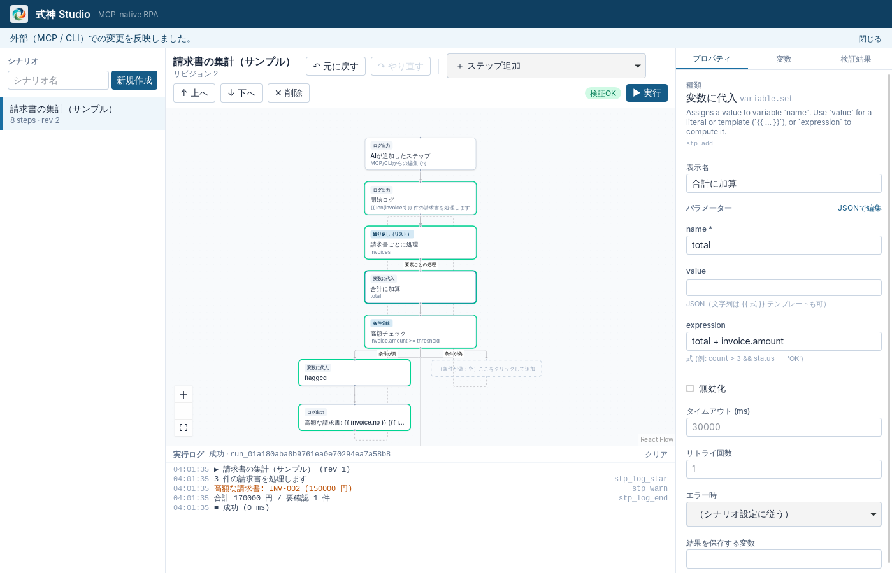

<p align="center">
  
</p>

# Shikigami

[English](README.md) | 日本語

AI（Claude Code / Codex / Cursor など）と人間が、**同じフロー** を作成・編集・実行・保守できるローカルファーストの RPA プラットフォームです。完成したフローは AI なし・GUI なしで実行できます。対象 OS は **Windows 10/11（x64）** です。



## 使い始める

1. [最新のリリース](https://github.com/d-shiina/shikigami/releases/latest)から `Shikigami.Studio_<版>_x64-setup.exe` をダウンロードして実行します。ユーザーごとのインストールなので、管理者権限は不要です。以降は Studio が自動で更新されます。
2. スタートメニューから **Shikigami Studio** を起動します。フローの画面の下にある「見本」から、完成したフローを開いて中身と動きを確認できます。
3. AI にフローの作成を依頼するには、[Claude Code](https://claude.com/claude-code) をインストールしてサインインし、Studio 左上の「Claude Code」（Ctrl+J）を開きます。「受注システムから未出荷の注文を集めるフローを作って」のように依頼すると、AI がフロー図にノードを追加していきます。
4. AI の変更はサイドバーの「確認待ち」で確認し、「確認して公開」を押します。公開したフローは、AI なしで Studio・実行画面「Shikigami 実行」・スケジュールから実行できます。

業務 1 本を最初から最後まで通して試すには、[チュートリアル](docs/ja/tutorials/README.md)（各 15 分ほど、見本のファイル付き）を参照してください。以下は開発者向けの情報です。

## 現在の状態

**Phase 1（基盤）と Phase 2（MCP サーバー）を実装済み。** Flow Core / Runtime / CLI / Studio（Tauri 2 + React）/ MCP サーバーが動作します。ブラウザ操作（Phase 3）も動作します（[docs/browser.md](docs/ja/browser.md)、`pnpm demo:browser` でデモ）。Windows のデスクトップアプリ操作（Phase 4）は UI Automation で動作します（[docs/desktop.md](docs/ja/desktop.md)）。Excel のブックは Excel なしで直接読み書きできます（[docs/office.md](docs/ja/office.md)）。詳細は [アーキテクチャ設計 §13](docs/ja/architecture.md#13-実装状況と制約)。

| ドキュメント | 内容 |
|---|---|
| [docs/tutorials/](docs/ja/tutorials/README.md) | チュートリアル：業務 1 本を、AI への依頼から毎月の実行まで通しで（売上 CSV を Excel に、受注一覧から請求書、Web の受注システム） |
| [docs/architecture.md](docs/ja/architecture.md) | システム構成、フロー形式、Adapter / MCP / IPC / DB / エラー / セキュリティ設計、設計判断、MVP 受け入れ基準 |
| [docs/mcp.md](docs/ja/mcp.md) | MCP サーバーの接続方法（Claude Code / Codex / Cursor）、ツール一覧、監査ログ、制約 |
| [docs/runner.md](docs/ja/runner.md) | 動かすだけの人の実行画面：公開されたフロー、入力変数から作るフォーム、結果とファイル |
| [docs/policy.md](docs/ja/policy.md) | 無人実行は承認・公開した版だけ、許可するサイト・アプリ、AI の操作の承認（`policy.json`） |
| [docs/schedules.md](docs/ja/schedules.md) | スケジュールとファイルのきっかけ、それを PC ごとに動かすエージェント |
| [docs/audit.md](docs/ja/audit.md) | 監査の記録：誰がどのフローを変更・公開・実行したか（`shikigami audit`）と保存期間 |
| [docs/remote.md](docs/ja/remote.md) | 管理サーバー：PC の登録、空いた PC へのジョブの振り分け、プロトコル v1 と参考実装のサーバー |
| [docs/oauth.md](docs/ja/oauth.md) | OAuth でサインインする Web API（Box など）。リダイレクト URL は固定のどんな URL でもよい |
| [docs/design/plugins.md](docs/design/plugins.md) | ノードのプラグイン：社内システムなど向けのノードを、本体を作り直さずに足す（マニフェスト + 別プロセス） |
| [docs/design/ui-principles.md](docs/design/ui-principles.md) | Studio の画面の決まり：ボタンをどこに置き、どう見せるか、その理由 |
| [docs/ja/compatibility.md](docs/ja/compatibility.md) | 互換性の方針：フロー形式（`schemaVersion`・移行・`requires`）、MCP・CLI で何を壊さないか |
| [docs/research.md](docs/research.md) | 採用ライブラリのバージョン・ライセンス・Windows 対応状況 |

## 構成

```text
crates/shikigami-core      Flow Core（唯一の正規データ層）
crates/shikigami-runtime   RPA Runtime（AI・GUI なしで実行）
crates/shikigami-cli       CLI（shikigami コマンド。`shikigami mcp` で MCP サーバー）
crates/shikigami-mcp       MCP サーバー（rmcp）
apps/studio                Shikigami Studio（Tauri 2 + React + React Flow）
packages/schema            Rust から生成した TypeScript 型
plugins/shikigami          Claude Code プラグイン（MCP 設定＋スキル）
schemas/                   生成された JSON Schema
examples/                  サンプルフロー
```

## 開発環境

| 必要なもの | バージョン |
|---|---|
| Rust | 1.90 以上（Windows は MSVC ツールチェーン） |
| Node.js | 22 LTS |
| pnpm | 10（`corepack enable` で自動） |

**Windows**：Visual Studio IDE は不要ですが、[Microsoft C++ Build Tools](https://visualstudio.microsoft.com/visual-cpp-build-tools/) の「Desktop development with C++」ワークロード（Windows SDK を含む）と WebView2（Windows 10 1803 以降は標準搭載）が必要です。Build Tools は 2022 でも 2026 でも動きます。インストールには管理者権限が要ります（会社 PC では管理者に依頼してください）。winget なら次のとおりです。

```powershell
winget install Microsoft.VisualStudio.2022.BuildTools --override "--wait --passive --add Microsoft.VisualStudio.Workload.VCTools --includeRecommended"
```

Rust を rustup で入れた場合は `rustup default stable-msvc` を設定してください。スタンドアロンのインストーラー（MSVC 版）でも、1.90 以上なら clippy・rustfmt 込みでそのまま使えます。

**Linux（コアの開発・CI 用。製品の対象外）**：`libwebkit2gtk-4.1-dev build-essential file libxdo-dev libssl-dev libayatana-appindicator3-dev librsvg2-dev`

```sh
pnpm install

# Studio のフロントエンドをビルド（Tauri のビルドスクリプトが dist を要求するため、
# clone 直後は cargo test / cargo build の前に一度必要）
pnpm --filter @shikigami/studio build

# テスト
cargo test --workspace
pnpm -r test

# CLI でサンプルを実行（AI・GUI なし）
cargo run -p shikigami-cli -- run examples/invoice-summary.json
cargo run -p shikigami-cli -- run examples/invoice-summary.json -i threshold=10000

# フル機能デモ：ブラウザ・ダイアログ・Excel・Word・メモ帳+OCR・Outlook などを
# 1 本で画面に見せる（詳細は examples/full-demo/README.md）
pnpm demo:full

# Studio を起動
pnpm studio:dev

# Rust の型を変更したら JSON Schema と TS 型を再生成
pnpm schema:generate
```

ワークスペース（フロー・履歴・実行記録の保存先）は既定で `%APPDATA%\Shikigami\workspace` です。環境変数 `SHIKIGAMI_HOME` または CLI の `--workspace` で変更できます。

### CLI の例

```sh
shikigami flow import examples/invoice-summary.json
shikigami flow list
echo '[{"op":"addStep","step":{"type":"log.message","params":{"message":"hello"}}}]' \
  | shikigami flow edit scn_example_invoice_summary -
shikigami flow undo scn_example_invoice_summary
shikigami run scn_example_invoice_summary --draft --json   # 作業中の内容を試す
shikigami version publish scn_example_invoice_summary       # 人が確認して公開
shikigami run scn_example_invoice_summary --json           # 無人実行は公開版だけを動かす
```

Studio を開いたまま CLI でフローを編集すると、変更が Studio に即座に反映されます。

## AI から使う（MCP）

Claude Code ならプラグインを入れるだけです（`shikigami` コマンドに PATH が通っている必要があります）。

```text
/plugin install shikigami --marketplace d-shiina/shikigami
```

Studio をインストールしている場合は、Studio と同じフォルダーにある `shikigami.exe` を登録すると Studio の更新と一緒に MCP サーバーも新しくなります（登録コマンドは Studio 右下のバージョン表示からコピーできます。詳しくは [docs/release.md](docs/ja/release.md)）。

MCP サーバーだけを登録する場合は `claude mcp add shikigami -- shikigami mcp`。リポジトリから開発していて PATH を通していない場合は、ビルドした実行ファイルを絶対パスで登録できます（`cargo build -p shikigami-cli` で更新されます）。

```powershell
claude mcp add --scope user shikigami -- C:\path\to\shikigami\target\debug\shikigami.exe mcp
```

この登録とプラグインを併用すると、プラグイン側の `shikigami` サーバー（PATH 上の `shikigami` を起動）は接続に失敗しますが、スキルは使えます。

Codex / Cursor の設定例とツール一覧は [docs/mcp.md](docs/ja/mcp.md) を参照してください。AI の変更は Studio に即座に反映され、Studio から元に戻せます。

## ライセンス

[Apache License 2.0](LICENSE)。貢献のしかたは [CONTRIBUTING.md](CONTRIBUTING.md)、脆弱性の報告は [SECURITY.md](SECURITY.md)、ファイル形式・MCP・CLI の互換方針は [docs/ja/compatibility.md](docs/ja/compatibility.md)、変更履歴は [CHANGELOG.md](CHANGELOG.md) を参照してください。
