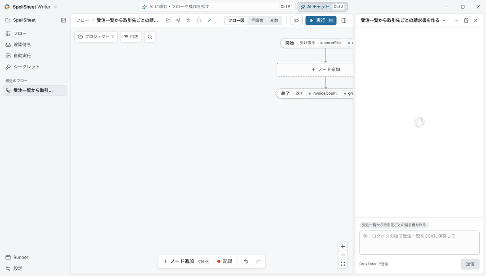

<p align="center">
  
</p>

# SpellSheet

<p align="center">
  <a href="https://github.com/spellsheet/spellsheet/actions/workflows/ci.yml"></a>
  <a href="https://github.com/spellsheet/spellsheet/releases/latest"></a>
  <a href="LICENSE"></a>
  
</p>

[English](README.md) | 日本語

> 名前は「式（spell）を書いた紙（sheet）」から来ています。以前の名前で出していた版から更新すると、設定・データのフォルダー、シークレット、自動実行のタスク、Writer の画面の設定、AI ツールの MCP 登録（名前は `spellsheet` になります。AI ツールを一度起動し直してください）まで、自動で引き継ぎます。

AI（Claude Code / Codex / Cursor など）と人間が、**同じフロー** を作成・編集・実行・保守できるローカルファーストの RPA プラットフォームです。完成したフローは AI なし・GUI なしで実行できます。対象 OS は **Windows 10/11（x64）** です。



<sub>この動画は、用意したフローを Writer の実際の画面で再生したものです。AI との実際のやり取りの録画ではなく、速さも AI の速さではありません。</sub>

## 使い始める

1. [最新のリリース](https://github.com/spellsheet/spellsheet/releases/latest)から `SpellSheet.Writer_<版>_x64-setup.exe` をダウンロードして実行します。ユーザーごとのインストールなので、管理者権限は不要です。以降は Writer が自動で更新されます。
2. スタートメニューから **SpellSheet Writer** を起動します。
3. AI にフローの作成を依頼するには、Writer 上部の「AI チャット」（Ctrl+J）を開き、使う AI（Claude Code・OpenAI Codex・Gemini CLI・GitHub Copilot）を選んで「Claude Code をインストールする」のようなボタンを押します。あなたのユーザーフォルダーに入り、続けてサインインの画面が出ます（ターミナルは要りません）。「受注システムから未出荷の注文を集めるフローを作って」のように依頼すると、AI がフロー図にノードを追加していきます。
4. AI の変更はサイドバーの「確認待ち」で確認し、「変更を承諾」を押します。確定したフローは、AI なしで Writer・実行画面「SpellSheet Runner」・スケジュールから実行できます。

インストーラーと `spellsheet.exe` はまだコード署名がないため（[Code signing policy](CODE_SIGNING_POLICY.md)）、初回に Windows SmartScreen の警告が出ることがあります。「詳細情報」→「実行」で進めてください。

**MCP クライアントだけで使う場合**：各リリースには、同じ MCP サーバーを MCP Bundle にした `spellsheet.mcpb` も付いています（Windows 10/11 x64 専用）。Bundle や [MCP Registry](https://registry.modelcontextprotocol.io/) からサーバーを入れるクライアントで使えます。AI が組んだものを見て確認するのは Writer です。[docs/ja/mcp.md](docs/ja/mcp.md) を参照してください。

以下は開発者向けの情報です。

画面の見方・フローのフォルダーの中身・テストケース・フローの渡し方・AI の準備など、業務で使う人向けの説明は[製品マニュアル](https://spellsheet.github.io/manual/)にあります。原稿は [apps/manual](apps/manual/) です。

## 現在の状態

Flow Core、Runtime、CLI、Writer と Runner（Tauri 2 + React）、MCP サーバー、Worker が動作します。組み込みのノードで、ブラウザ（[docs/browser.md](docs/ja/browser.md)、`pnpm demo:browser` でデモ）、UI Automation による Windows のデスクトップアプリ（[docs/desktop.md](docs/ja/desktop.md)）、Excel なしでの Excel ブックの読み書き（[docs/office.md](docs/ja/office.md)）、Word、メール、ファイル、PDF、データベース、OCR を扱えます。1.0 より前の版です。フローの形式と MCP のツールは [docs/compatibility.md](docs/ja/compatibility.md) に従い、分かっている制約は [アーキテクチャ設計 §13](docs/ja/architecture.md#13-実装状況と制約) にあります。

Writer の画面は日本語と英語に対応しています（左上の「SpellSheet Writer」のメニューか「設定」で切り替えます。選ぶまでは OS の言語に合わせます）。

| ドキュメント | 内容 |
|---|---|
| [docs/architecture.md](docs/ja/architecture.md) | システム構成、フロー形式、Adapter / MCP / IPC / DB / エラー / セキュリティ設計、設計判断、MVP 受け入れ基準 |
| [docs/mcp.md](docs/ja/mcp.md) | MCP サーバーの接続方法（Claude Code / Codex / Cursor）、ツール一覧、監査ログ、制約 |
| [docs/ai-chat.md](docs/ja/ai-chat.md) | MCP を使えない AI のチャット（Microsoft Copilot など）でフローを作る：渡す仕様書、答えの貼り付け、人の手直し |
| [docs/runner.md](docs/ja/runner.md) | 動かすだけの人の実行画面：確定されたフロー、入力変数から作るフォーム、結果とファイル |
| [docs/policy.md](docs/ja/policy.md) | 無人実行は承認・確定した版だけ、許可するサイト・アプリ、AI の操作の承認（`policy.json`） |
| [docs/schedules.md](docs/ja/schedules.md) | スケジュールとファイルのきっかけ、それを PC ごとに動かす Worker |
| [docs/audit.md](docs/ja/audit.md) | 監査の記録：誰がどのフローを変更・確定・実行したか（`spellsheet audit`）と保存期間 |
| [docs/remote.md](docs/ja/remote.md) | 管理サーバー：PC の登録、空いた PC へのジョブの振り分け、プロトコル v1 と参考実装のサーバー |
| [docs/oauth.md](docs/ja/oauth.md) | OAuth でサインインする Web API（Box など）。リダイレクト URL は固定のどんな URL でもよい |
| [docs/ja/extensions.md](docs/ja/extensions.md) | カスタム ノード：クラウド型 AI-OCR・社内システム・SaaS の API などのノードを後から追加（zip・URL・GitHub から導入） |
| [docs/design/plugins.md](docs/design/plugins.md) | ノードのプラグイン：社内システムなど向けのノードを、本体を作り直さずに足す（マニフェスト + 別プロセス） |
| [docs/design/ui-principles.md](docs/design/ui-principles.md) | Writer の画面の決まり：ボタンをどこに置き、どう見せるか、その理由 |
| [docs/ja/compatibility.md](docs/ja/compatibility.md) | 互換性の方針：フロー形式（`schemaVersion`・移行・`requires`）、MCP・CLI で何を壊さないか |
| [docs/research.md](docs/research.md) | 採用ライブラリのバージョン・ライセンス・Windows 対応状況 |

## 構成

```text
crates/
  spellsheet-core       Flow Core：フローのモデル・検証・編集・履歴・保存（フローのデータの唯一の正規層）
  spellsheet-runtime    AI・GUI なしでフローを実行
  spellsheet-cli        spellsheet コマンド（`spellsheet mcp` で MCP サーバー）
  spellsheet-mcp        MCP サーバー（rmcp）
  spellsheet-agent      Worker：各 PC での無人実行（スケジュール、ファイルトリガー、管理サーバー）
  spellsheet-manager    Worker 用の小さな参照実装の管理サーバー
  spellsheet-adapters   組み込みノードの一覧（登録は 1 か所）
  spellsheet-browser    browser.*（packages/browser-adapter の Node.js＋Playwright を動かす）
  spellsheet-desktop    desktop.*（Windows UI Automation、Java Access Bridge、OCR）
  spellsheet-excel      excel.*（.xlsx を Excel なしで直接読み書き）
  spellsheet-word       word.*
  spellsheet-mail       mail.*（Outlook、Microsoft 365、SMTP）
  spellsheet-files      file.*
  spellsheet-pdf        pdf.*
  spellsheet-db         db.*（ODBC）
  spellsheet-system     http.*、process.*、clipboard.*、dialog.*
  spellsheet-com        Office 向けの COM 呼び出し（遅延バインドの IDispatch）
  spellsheet-secrets    ログイン情報の保管庫（鍵は Windows 資格情報マネージャー）
  spellsheet-plugins    ノードプラグイン：外部プログラムが提供するノード
apps/studio             SpellSheet Writer と Runner（Tauri 2 + React + React Flow）
packages/schema         Rust の型から生成した TypeScript 型
packages/browser-adapter  ブラウザ操作のプロセス（Playwright）
plugins/spellsheet      Claude Code プラグイン（MCP 設定＋スキル）
schemas/                生成された JSON Schema（公開している約束）
examples/               サンプルフロー（CI が最後まで実行して確かめる）、カスタム ノードの例
```

`spellsheet-core` はワークスペース内のどのクレートにも依存せず、入口（Writer・CLI・MCP サーバー・Worker）はすべてこれを通してフローを編集します。`unsafe` は Windows API を呼ぶモジュールだけに許し、それ以外はワークスペースの lint で禁止しています。設計の全体は [docs/architecture.md](docs/ja/architecture.md) を参照してください。

## 開発環境

| 必要なもの | バージョン |
|---|---|
| Rust | 1.90 以上（Windows は MSVC ツールチェーン） |
| Node.js | 22 LTS |
| pnpm | 10（`corepack enable` で自動） |

**Windows**：Visual Studio IDE は不要ですが、[Microsoft C++ Build Tools](https://visualstudio.microsoft.com/visual-cpp-build-tools/) の「Desktop development with C++」ワークロード（Windows SDK を含む）と WebView2（Windows 10 1803 以降は標準搭載）が必要です。Build Tools は 2022 でも 2026 でも動きます。インストールには管理者権限が要ります（会社 PC では管理者に依頼してください）。winget なら次のとおりです。

```powershell
winget install Microsoft.VisualStudio.2022.BuildTools --override "--wait --passive --add Microsoft.VisualStudio.Workload.VCTools --includeRecommended"
```

Rust を rustup で入れた場合は `rustup default stable-msvc` を設定してください。スタンドアロンのインストーラー（MSVC 版）でも、1.90 以上なら clippy・rustfmt 込みでそのまま使えます。

**Linux（コアの開発・CI 用。製品の対象外）**：`libwebkit2gtk-4.1-dev build-essential file libxdo-dev libssl-dev libayatana-appindicator3-dev librsvg2-dev`

```sh
pnpm install

# Writer のフロントエンドをビルド（Tauri のビルドスクリプトが dist を要求するため、
# clone 直後は cargo test / cargo build の前に一度必要）
pnpm --filter @spellsheet/studio build

# テスト
cargo test --workspace
pnpm -r test

# CLI でサンプルを実行（AI・GUI なし）
cargo run -p spellsheet-cli -- run examples/invoice-summary.json
cargo run -p spellsheet-cli -- run examples/invoice-summary.json -i threshold=10000

# フル機能デモ：ブラウザ・ダイアログ・Excel・Word・メモ帳+OCR・Outlook などを
# 1 本で画面に見せる（詳細は examples/full-demo/README.md）
pnpm demo:full

# Writer を起動
pnpm studio:dev

# Rust の型を変更したら JSON Schema と TS 型を再生成
pnpm schema:generate
```

ワークスペース（フロー・履歴・実行記録の保存先）は既定で `%APPDATA%\SpellSheet\workspace` です。環境変数 `SPELLSHEET_HOME`または CLI の `--workspace` で変更できます。

### CLI の例

```sh
spellsheet flow import examples/invoice-summary.json
spellsheet flow list
echo '[{"op":"addStep","step":{"type":"log.message","params":{"message":"hello"}}}]' \
  | spellsheet flow edit scn_example_invoice_summary -
spellsheet flow undo scn_example_invoice_summary
spellsheet run scn_example_invoice_summary --draft --json   # 作業中の内容を試す
spellsheet version publish scn_example_invoice_summary       # 人が確定
spellsheet run scn_example_invoice_summary --json           # 無人実行は確定版だけを動かす
```

Writer を開いたまま CLI でフローを編集すると、変更が Writer に即座に反映されます。

## AI から使う（MCP）

Claude Code ならプラグインを入れるだけです（`spellsheet` コマンドに PATH が通っている必要があります）。

```text
/plugin install spellsheet --marketplace spellsheet/spellsheet
```

Writer をインストールしている場合は、Writer と同じフォルダーにある `spellsheet.exe` を登録すると Writer の更新と一緒に MCP サーバーも新しくなります（登録コマンドは Writer の「設定」→「AI」の「MCP サーバーの登録」でコピーできます。詳しくは [docs/release.md](docs/ja/release.md)）。

MCP サーバーだけを登録する場合は `claude mcp add spellsheet -- spellsheet mcp`。リポジトリから開発していて PATH を通していない場合は、ビルドした実行ファイルを絶対パスで登録できます（`cargo build -p spellsheet-cli` で更新されます）。

```powershell
claude mcp add --scope user spellsheet -- C:\path\to\spellsheet\target\debug\spellsheet.exe mcp
```

この登録とプラグインを併用すると、プラグイン側の `spellsheet` サーバー（PATH 上の `spellsheet` を起動）は接続に失敗しますが、スキルは使えます。

Codex / Cursor の設定例とツール一覧は [docs/mcp.md](docs/ja/mcp.md) を参照してください。AI の変更は Writer に即座に反映され、Writer から元に戻せます。

## ライセンス

[Apache License 2.0](LICENSE)。貢献のしかたは [CONTRIBUTING.md](CONTRIBUTING.md)、脆弱性の報告は [SECURITY.md](SECURITY.md)、インストーラーの署名は [Code signing policy](CODE_SIGNING_POLICY.md)、ファイル形式・MCP・CLI の互換方針は [docs/ja/compatibility.md](docs/ja/compatibility.md)、変更履歴は [CHANGELOG.md](CHANGELOG.md) を参照してください。
