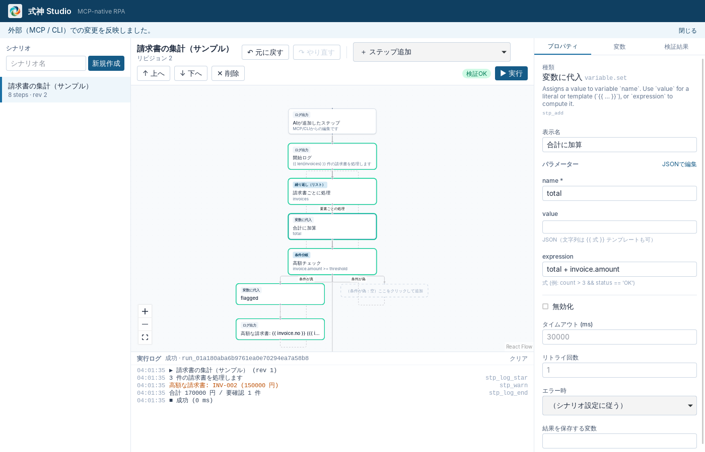

<p align="center">
  
</p>

# Shikigami（式神）

MCP-native desktop RPA where AI and humans build, edit, and run the same automation scenarios.

AI（Claude Code / Codex / Cursor など）と人間が、**同じシナリオ** を作成・編集・実行・保守できるローカルファーストの RPA プラットフォームです。完成したシナリオは AI なし・GUI なしで実行できます。対象 OS は **Windows 10/11（x64）** です。



## 現在の状態

**Phase 1（基盤）と Phase 2（MCP サーバー）を実装済み。** Scenario Core / Runtime / CLI / Studio（Tauri 2 + React）/ MCP サーバーが動作します。ブラウザ操作（Phase 3）、Windows 操作（Phase 4）は未実装です。詳細は [アーキテクチャ設計 §13](docs/architecture.md#13-実装状況と制約)。

| ドキュメント | 内容 |
|---|---|
| [docs/architecture.md](docs/architecture.md) | システム構成、シナリオ形式、Adapter / MCP / IPC / DB / エラー / セキュリティ設計、設計判断、MVP 受け入れ基準 |
| [docs/mcp.md](docs/mcp.md) | MCP サーバーの接続方法（Claude Code / Codex / Cursor）、ツール一覧、監査ログ、制約 |
| [docs/research.md](docs/research.md) | 採用ライブラリのバージョン・ライセンス・Windows 対応状況 |

## 構成

```text
crates/shikigami-core      Scenario Core（唯一の正規データ層）
crates/shikigami-runtime   RPA Runtime（AI・GUI なしで実行）
crates/shikigami-cli       CLI（shikigami コマンド。`shikigami mcp` で MCP サーバー）
crates/shikigami-mcp       MCP サーバー（rmcp）
apps/studio                Shikigami Studio（Tauri 2 + React + React Flow）
packages/schema            Rust から生成した TypeScript 型
plugins/shikigami          Claude Code プラグイン（MCP 設定＋スキル）
schemas/                   生成された JSON Schema
examples/                  サンプルシナリオ
```

## 開発環境

| 必要なもの | バージョン |
|---|---|
| Rust | 1.90 以上（Windows は MSVC ツールチェーン） |
| Node.js | 22 LTS |
| pnpm | 10（`corepack enable` で自動） |

**Windows**：Visual Studio IDE は不要ですが、[Microsoft C++ Build Tools](https://visualstudio.microsoft.com/visual-cpp-build-tools/) の「Desktop development with C++」ワークロード（Windows SDK を含む）と WebView2（Windows 10 1803 以降は標準搭載）が必要です。`rustup default stable-msvc` を設定してください。

**Linux（コアの開発・CI 用。製品の対象外）**：`libwebkit2gtk-4.1-dev build-essential file libxdo-dev libssl-dev libayatana-appindicator3-dev librsvg2-dev`

```sh
pnpm install

# テスト
cargo test --workspace
pnpm -r test

# CLI でサンプルを実行（AI・GUI なし）
cargo run -p shikigami-cli -- run examples/invoice-summary.json
cargo run -p shikigami-cli -- run examples/invoice-summary.json -i threshold=10000

# Studio を起動
pnpm studio:dev

# Rust の型を変更したら JSON Schema と TS 型を再生成
pnpm schema:generate
```

ワークスペース（シナリオ・履歴・実行記録の保存先）は既定で `%APPDATA%\Shikigami\workspace` です。環境変数 `SHIKIGAMI_HOME` または CLI の `--workspace` で変更できます。

### CLI の例

```sh
shikigami scenario import examples/invoice-summary.json
shikigami scenario list
echo '[{"op":"addStep","step":{"type":"log.message","params":{"message":"hello"}}}]' \
  | shikigami scenario edit scn_example_invoice_summary -
shikigami scenario undo scn_example_invoice_summary
shikigami run scn_example_invoice_summary --json
```

Studio を開いたまま CLI でシナリオを編集すると、変更が Studio に即座に反映されます。

## AI から使う（MCP）

Claude Code ならプラグインを入れるだけです（`shikigami` コマンドに PATH が通っている必要があります）。

```text
/plugin install shikigami --marketplace d-shiina/shikigami
```

MCP サーバーだけを登録する場合は `claude mcp add shikigami -- shikigami mcp`。Codex / Cursor の設定例とツール一覧は [docs/mcp.md](docs/mcp.md) を参照してください。AI の変更は Studio に即座に反映され、Studio から元に戻せます。
