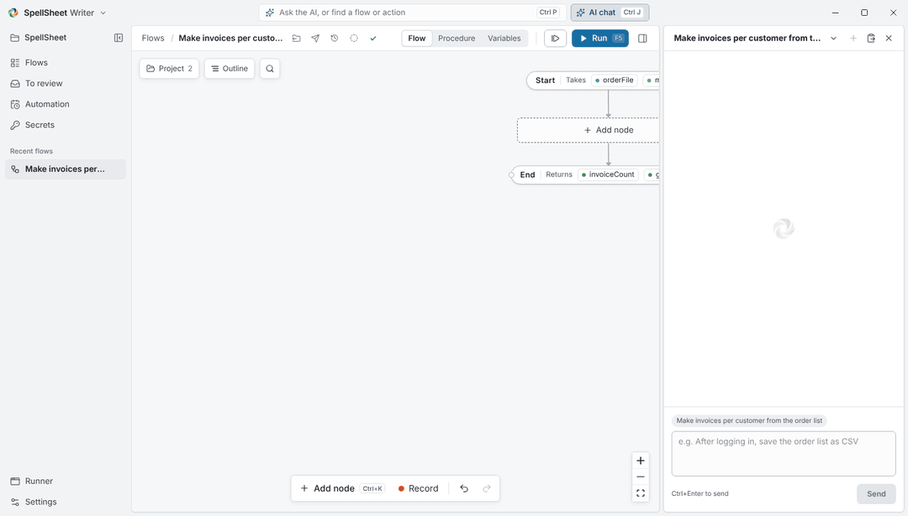

<p align="center">
  
</p>

# SpellSheet

<p align="center">
  <a href="https://github.com/spellsheet/spellsheet/actions/workflows/ci.yml"></a>
  <a href="https://github.com/spellsheet/spellsheet/releases/latest"></a>
  <a href="LICENSE"></a>
  
</p>

English | [日本語](README.ja.md)

> The name comes from a spell written on a sheet. Updating from a build released under the product's earlier name carries everything over by itself: the settings and data folders, secrets, scheduled tasks, Writer's screen settings, and the MCP setup of your AI clients (renamed to `spellsheet`; restart the AI client once).

MCP-native desktop RPA where AI and humans build, edit, and run the same automation flows.

SpellSheet is a local-first RPA platform where AI clients (Claude Code, Codex, Cursor and others) and people create, edit, run and maintain **the same flows**. AI builds them; finished flows run without AI and without a GUI. The target OS is **Windows 10/11 (x64)**.



<sub>The clip shows Writer's real screens replayed with a prepared flow; it is not a recording of a live AI session, and the speed is not the AI's.</sub>

## Getting started

1. Download `SpellSheet.Writer_<version>_x64-setup.exe` from the [latest release](https://github.com/spellsheet/spellsheet/releases/latest) and run it. It installs per user, so no administrator rights are needed. Writer updates itself from then on.
2. Start **SpellSheet Writer** from the Start menu.
3. To have AI build flows, open "AI chat" at the top of Writer (Ctrl+J), pick the AI you use (Claude Code, OpenAI Codex, Antigravity, Gemini CLI, GitHub Copilot or Cursor) and press its button, such as "Install Claude Code": it goes into your user folder and the sign-in follows, with no terminal. Ask something like "make a flow that collects unshipped orders from the order system" and the AI adds nodes to the flow chart as it goes.
4. Check the AI's changes under "To review" in the sidebar and press "Accept changes". Published flows run without AI from Writer, from the "SpellSheet Runner" window, or on a schedule.

The installer and `spellsheet.exe` are not code-signed yet ([Code signing policy](CODE_SIGNING_POLICY.md)), so Windows SmartScreen may warn on the first run; choose "More info", then "Run anyway".

**Using only an MCP client?** Each release also has `spellsheet.mcpb`, an MCP Bundle with the same MCP server (Windows 10/11 x64 only), for clients that install servers from a bundle or from the [MCP Registry](https://registry.modelcontextprotocol.io/). Writer is still the place to see and review what the AI builds. See [docs/mcp.md](docs/mcp.md).

The rest of this page is for developers.

The [user manual](https://spellsheet.github.io/manual/) (in Japanese for now) explains every screen, the folders a flow keeps, test cases, sharing a flow and the AI setup for the people who use SpellSheet at work. Its source is [apps/manual](apps/manual/).

## Status

Flow Core, the Runtime, the CLI, Writer and Runner (Tauri 2 + React), the MCP server and the Worker all work. Built-in nodes cover browsers ([docs/browser.md](docs/browser.md); try `pnpm demo:browser`), Windows desktop apps through UI Automation ([docs/desktop.md](docs/desktop.md)), Excel workbooks read and written without Excel ([docs/office.md](docs/office.md)), Word, mail, files, PDF, databases and OCR. SpellSheet is pre-1.0: the flow format and the MCP tools follow [docs/compatibility.md](docs/compatibility.md), and the known limits are in [architecture §13](docs/architecture.md#13-implementation-status-and-limits).

Writer's UI is available in English and Japanese (the language menu under "SpellSheet Writer" at the top left, or Settings; it follows the OS language until you choose).

| Document | Contents |
|---|---|
| [docs/architecture.md](docs/architecture.md) | System layout, flow format, adapter / MCP / IPC / DB / error / security design, design decisions, MVP acceptance criteria |
| [docs/mcp.md](docs/mcp.md) | Connecting the MCP server (Claude Code / Codex / Cursor), tool list, audit log, limits |
| [docs/inventory.md](docs/inventory.md) | Work inventory: the AI interviews you about your work, and SpellSheet shows what takes your time and what to automate first |
| [docs/ai-chat.md](docs/ai-chat.md) | Building flows with an AI chat that has no MCP (Microsoft Copilot): the guide to give it, pasting its answer into Writer, what is left for a person |
| [docs/runner.md](docs/runner.md) | The run window for the people who only run flows: published flows, a form made from the inputs, results and files |
| [docs/policy.md](docs/policy.md) | Unattended runs use only an approved, published version; allowed sites and apps; approving AI operations (`policy.json`) |
| [docs/expressions.md](docs/expressions.md) | Functions available in flow expressions |
| [docs/browser.md](docs/browser.md), [docs/desktop.md](docs/desktop.md), [docs/office.md](docs/office.md), [docs/files.md](docs/files.md), [docs/system.md](docs/system.md), [docs/pdf.md](docs/pdf.md), [docs/database.md](docs/database.md) | Built-in nodes: browser, Windows apps, Excel / Word / mail, files, HTTP / programs / clipboard / dialogs, PDF, databases |
| [docs/testing.md](docs/testing.md) | Test cases: inputs and expected outputs kept with a flow, run with `spellsheet test` |
| [docs/schedules.md](docs/schedules.md) | Schedules and file triggers; the worker that runs them on each PC |
| [docs/audit.md](docs/audit.md) | One audit trail: who changed, published and ran which flow (`spellsheet audit`), and how long it is kept |
| [docs/remote.md](docs/remote.md) | Management server: enroll PCs, hand jobs to whichever is free, protocol v1 and a reference server |
| [docs/secrets.md](docs/secrets.md) | Logins: secrets the AI refers to by name only |
| [docs/oauth.md](docs/oauth.md) | Web APIs that need an OAuth sign-in (Box and others), with any fixed redirect URL |
| [docs/adapters.md](docs/adapters.md) | Where each node type comes from, and node plugins |
| [docs/release.md](docs/release.md) | Installer, updates and release signing |
| [docs/extensions.md](docs/extensions.md) | Plugins: add nodes (cloud AI-OCR, in-house systems, SaaS APIs) after the fact; install from a zip, URL or GitHub |
| [docs/design/plugins.md](docs/design/plugins.md) (Japanese) | Node plugins: add nodes for in-house systems without rebuilding SpellSheet (manifest + separate process) |
| [docs/design/ui-principles.md](docs/design/ui-principles.md) (Japanese) | Writer's layout rules: where each button goes and how it looks, and why |
| [docs/compatibility.md](docs/compatibility.md) | Compatibility policy: the flow format (`schemaVersion`, migration, `requires`) and what MCP and the CLI never break |
| [docs/research.md](docs/research.md) (Japanese) | Versions, licenses and Windows support of the libraries used |

The design notes under `docs/design/` and `docs/research.md` are in Japanese. Japanese versions of the guides above are in [docs/ja/](docs/ja/).

## Layout

```text
crates/
  spellsheet-core       Flow Core: the flow model, validation, editing, history and storage (the only source of truth for flow data)
  spellsheet-runtime    Runs flows without AI or a GUI
  spellsheet-cli        The `spellsheet` command (`spellsheet mcp` is the MCP server)
  spellsheet-mcp        MCP server (rmcp)
  spellsheet-agent      Worker: unattended runs on each PC (schedules, file triggers, management server)
  spellsheet-manager    A small reference management server for Workers
  spellsheet-adapters   The list of built-in node families, registered in one place
  spellsheet-browser    browser.*  (drives the Node.js + Playwright adapter in packages/browser-adapter)
  spellsheet-desktop    desktop.*  (Windows UI Automation, Java Access Bridge, OCR)
  spellsheet-excel      excel.*    (.xlsx read and written directly, without Excel)
  spellsheet-word       word.*
  spellsheet-mail       mail.*     (Outlook, Microsoft 365, SMTP)
  spellsheet-files      file.*
  spellsheet-pdf        pdf.*
  spellsheet-db         db.*       (ODBC)
  spellsheet-system     http.*, process.*, clipboard.*, dialog.*
  spellsheet-com        COM automation helpers for Office (late-bound IDispatch)
  spellsheet-secrets    Secret vault (key held by Windows Credential Manager)
  spellsheet-plugins    Node plugins: node types provided by external programs
apps/studio             SpellSheet Writer and Runner (Tauri 2 + React + React Flow)
packages/schema         TypeScript types generated from the Rust types
packages/browser-adapter  Browser automation process (Playwright)
plugins/spellsheet      Claude Code plugin (MCP settings + skill)
schemas/                Generated JSON Schema (public contract)
examples/               Sample flows (CI runs them end to end) and example plugins
```

`spellsheet-core` depends on no other crate in the workspace; every entry point (Writer, CLI, MCP server, Worker) edits flows through it. The crates that touch Windows APIs keep `unsafe` to the modules that call them; everywhere else it is forbidden by the workspace lints. See [docs/architecture.md](docs/architecture.md) for the full design.

## Development

| Requirement | Version |
|---|---|
| Rust | 1.90 or later (MSVC toolchain on Windows) |
| Node.js | 22 LTS |
| pnpm | 10 (`corepack enable` sets it up) |

**Windows**: Visual Studio itself is not needed, but you need the "Desktop development with C++" workload of [Microsoft C++ Build Tools](https://visualstudio.microsoft.com/visual-cpp-build-tools/) (it includes the Windows SDK) and WebView2 (built into Windows 10 1803 and later). Build Tools 2022 and 2026 both work. Installing them requires administrator rights (ask your administrator on a company PC). With winget:

```powershell
winget install Microsoft.VisualStudio.2022.BuildTools --override "--wait --passive --add Microsoft.VisualStudio.Workload.VCTools --includeRecommended"
```

If you installed Rust with rustup, run `rustup default stable-msvc`. The standalone (MSVC) installer works as is, clippy and rustfmt included, as long as it is 1.90 or later.

**Linux (for core development and CI only; not a product target)**: `libwebkit2gtk-4.1-dev build-essential file libxdo-dev libssl-dev libayatana-appindicator3-dev librsvg2-dev`

```sh
pnpm install

# Build Writer's frontend (Tauri's build script needs dist, so after a fresh
# clone this is needed once before cargo test / cargo build)
pnpm --filter @spellsheet/studio build

# Tests
cargo test --workspace
pnpm -r test

# Run a sample with the CLI (no AI, no GUI)
cargo run -p spellsheet-cli -- run examples/invoice-summary.json
cargo run -p spellsheet-cli -- run examples/invoice-summary.json -i threshold=10000

# Full-feature demo on screen: browser, dialogs, Excel, Word, Notepad + OCR,
# Outlook and more in one flow (see examples/full-demo/README.md)
pnpm demo:full

# Start Writer
pnpm studio:dev

# Regenerate the JSON Schema and TS types after changing Rust types
pnpm schema:generate
```

The workspace (where flows, history and run records are stored) defaults to `%LOCALAPPDATA%\SpellSheet\workspace` (builds up to 0.1.20 kept it in `%APPDATA%`; it moves on the first start). Change it with the `SPELLSHEET_HOME` environment variable or the CLI's `--workspace`.

### CLI examples

```sh
spellsheet flow import examples/invoice-summary.json
spellsheet flow list
echo '[{"op":"addStep","step":{"type":"log.message","params":{"message":"hello"}}}]' \
  | spellsheet flow edit scn_example_invoice_summary -
spellsheet flow undo scn_example_invoice_summary
spellsheet run scn_example_invoice_summary --draft --json   # try the work in progress
spellsheet version publish scn_example_invoice_summary       # a person reviews and publishes
spellsheet run scn_example_invoice_summary --json           # unattended runs use only the published version
```

Edits made with the CLI while Writer is open show up in Writer immediately.

## Using it from AI (MCP)

In Claude Code, install the plugin (the `spellsheet` command must be on PATH):

```text
/plugin install spellsheet --marketplace spellsheet/spellsheet
```

If you installed Writer, register the `spellsheet.exe` in Writer's folder so the MCP server is updated together with Writer (copy the command from "MCP server registration" under Settings → AI in Writer; see [docs/release.md](docs/release.md)).

To register only the MCP server: `claude mcp add spellsheet -- spellsheet mcp`. When developing from the repository without `spellsheet` on PATH, register the built executable by its absolute path (`cargo build -p spellsheet-cli` updates it):

```powershell
claude mcp add --scope user spellsheet -- C:\path\to\spellsheet\target\debug\spellsheet.exe mcp
```

With this registration and the plugin both in place, the plugin's own `spellsheet` server (which starts `spellsheet` from PATH) fails to connect, but its skill still works.

See [docs/mcp.md](docs/mcp.md) for Codex / Cursor settings and the tool list. AI edits show up in Writer immediately and can be undone from Writer.

## License

[Apache License 2.0](LICENSE). See [CONTRIBUTING.md](CONTRIBUTING.md) for contributing, [SECURITY.md](SECURITY.md) for reporting vulnerabilities, [Code signing policy](CODE_SIGNING_POLICY.md) for how the installers are signed, [docs/compatibility.md](docs/compatibility.md) for the file format, MCP and CLI compatibility policy, and [CHANGELOG.md](CHANGELOG.md) for changes.
