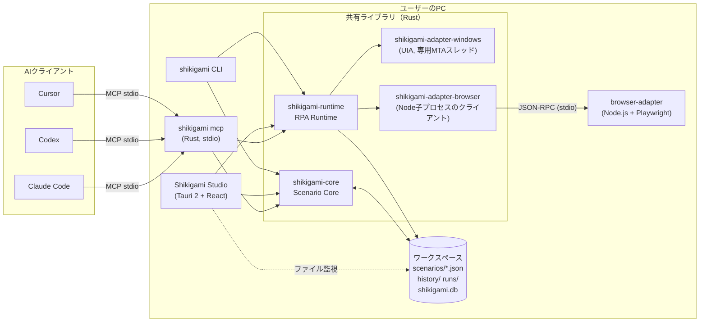
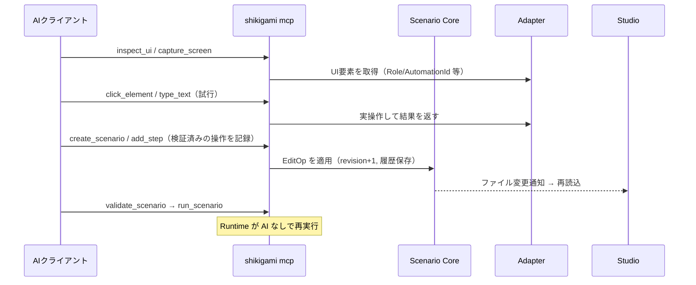

# Shikigamiアーキテクチャ設計

> MCP ネイティブなデスクトップ RPA。AI と人間が **同じシナリオ** を作成・編集・実行・保守する。
>
> 本書は設計の正本。実装状況は [§13](#13-phase-1-の実装状況と制約) を参照。技術調査は [research.md](research.md)。

## 0. 設計原則

1. **Scenario Core が唯一の正規データ管理層。** GUI・MCP・CLI・Runtime はすべて Core の API（`ScenarioService`）を通じてのみシナリオを読み書きする。シナリオ処理ロジックを重複実装しない。
2. **すべての変更は EditOp。** 変更は逆操作を持つ `EditOp` の列として表現する。Undo/Redo、競合検出、変更履歴、AI 修正案の差分提示はすべてこの上に成り立つ。
3. **実行に AI も GUI も要らない。** Runtime はヘッドレスのライブラリで、CLI・Studio・MCP サーバーから同じものを使う。
4. **ローカルファースト。** データはローカルのワークスペース（ファイル）に置き、クラウドに依存しない。
5. **小さく始める。** マイクロサービス化しない。プロセスを分けるのは技術的に必要な箇所（MCP の stdio、Playwright の Node.js）だけ。
6. **Windows 特化。** 製品の対象 OS は Windows 10/11（x64）のみ。macOS / Linux 向けの配布・OS 抽象化・動作確認は行わない（[判断9](#判断9windows-特化os-の抽象化レイヤーは作らない)）。

## 1. システムアーキテクチャ



### プロセスモデル

| プロセス | 起動者 | 役割 |
|---|---|---|
| `shikigami-studio` | ユーザー | GUI。Core/Runtime をライブラリとして内包 |
| `shikigami mcp` | AI クライアント（stdio 子プロセス） | MCP ツールを提供。GUI なしで単独動作。CLI と同じ実行ファイルのサブコマンド（配布物を 1 つにするため） |
| `shikigami` (CLI) | ユーザー / スケジューラー | ヘッドレス実行・管理 |
| `browser-adapter` (Node) | Runtime | Playwright 操作。必要時のみ起動 |

Studio と MCP サーバーは **別プロセスで同じワークスペースを共有** する。同期は §7 の「ファイルを正とした楽観的並行制御＋変更通知」で行う。

### 処理の流れ：AI によるシナリオ生成（§6 のフロー）



**AI の操作（探索）とシナリオの保存は別ツール。** `click_element` 等の UI 操作ツールはシナリオを変更しない。シナリオに残すには明示的に `add_step` する。

## 2. Monorepo 構成

```text
shikigami/
├─ Cargo.toml                 Rust ワークスペース
├─ package.json               pnpm ワークスペース（scripts のみ）
├─ pnpm-workspace.yaml
├─ crates/
│  ├─ shikigami-core/         Scenario Core（モデル・式・検証・EditOp・履歴・保存・Schema出力）
│  ├─ shikigami-runtime/      RPA Runtime（インタプリタ・Handler IF・実行記録）
│  ├─ shikigami-cli/          CLI（`shikigami` バイナリ）
│  ├─ shikigami-mcp/          MCP サーバー（rmcp、`shikigami mcp` で起動）
│  ├─ shikigami-adapter-browser/  [Phase 3] Node サイドカーのクライアント
│  ├─ shikigami-desktop/  [Phase 4] desktop.*（UI Automation）
│  ├─ shikigami-excel/    excel.*（xlsx を直接読み書き）
│  ├─ shikigami-files/    file.*（テキスト・CSV・コピー/移動/削除・zip）
│  └─ shikigami-plugins/  ノードのプラグイン（マニフェストで宣言、別プロセスで実行）
├─ apps/
│  └─ studio/                 Tauri 2 + React（src/ がフロント、src-tauri/ が Rust）
├─ packages/
│  ├─ schema/                 @shikigami/schema：Rust から生成した TS 型
│  └─ browser-adapter/        [Phase 3] Node.js + Playwright
├─ plugins/shikigami/        Claude Code プラグイン（MCP 設定＋スキル）
├─ schemas/                   生成された JSON Schema（コミット対象、CI でズレ検出）
├─ examples/                  サンプルシナリオ（テストでも使用）
└─ docs/                      設計書・調査・アセット
```

**型の流れ：** Rust 型 → (`schemars`) → `schemas/*.schema.json` → (`json-schema-to-typescript`) → `packages/schema/src/generated.ts`。Rust と TS の型ズレは、Rust 側テスト（`committed_schemas_are_up_to_date`）と TS 側テスト（`generated types match`）の両方で CI が検出する。

## 3. Rust Workspace 構成

| クレート | 依存 | 主な公開 API |
|---|---|---|
| `shikigami-core` | serde, schemars, jsonschema, uuid, time, tempfile | `Scenario`, `Step`, `EditOp`, `ScenarioService`, `FileStore`, `Validator`, `StepRegistry`, `expr` |
| `shikigami-runtime` | core, tokio, tokio-util | `Runtime`, `RuntimeBuilder::register`, `ActionHandler`, `RunHandle`, `RunEvent`, `record::*` |
| `shikigami-cli` | core, runtime, mcp, clap | `shikigami scenario/run/validate/step-types/schema/mcp` |
| `shikigami-studio` | core, runtime, tauri, notify | Tauri コマンド（§7.1） |
| `shikigami-mcp` | core, runtime, rmcp | `ShikigamiMcp`（MCP ツール、§6）, `serve_stdio` |
| `shikigami-adapter-*` (P3/P4) | runtime | `StepTypeDef` + `ActionHandler` の組 |

依存方向は **core ← runtime ← adapters ← (studio | mcp | cli)** の一方向。core は tokio にも Tauri にも依存しない（同期 API、どこからでも使える）。

コード品質ルール：`unsafe_code = "forbid"`（Windows Adapter のみ例外として局所的に許可予定）、`clippy::unwrap_used/expect_used/panic = warn`（CI では `-D warnings`）。

## 4. Scenario Schema

正規形式は JSON（`schemas/scenario.schema.json`）。例：[examples/invoice-summary.json](../examples/invoice-summary.json)。

```jsonc
{
  "schemaVersion": 1,             // ファイル形式のバージョン
  "id": "scn_…",                  // 安定ID（ファイル名にもなる）
  "name": "請求書の集計",
  "description": "…",
  "revision": 12,                 // 変更ごとに+1。競合検出に使用
  "variables": [
    { "name": "invoices", "type": "array", "direction": "input", "default": [] },
    { "name": "password", "type": "string", "direction": "input", "secret": true }
  ],
  "steps": [
    { "id": "stp_…", "type": "control.forEach",
      "params": { "items": "invoices", "itemVar": "invoice" },
      "blocks": { "body": [
        { "id": "stp_…", "type": "browser.fill",
          "params": { "target": { "role": "textbox", "name": "請求番号" }, "value": "{{ invoice.no }}" },
          "retry": { "maxAttempts": 3 }, "timeoutMs": 10000, "onError": "fail" }
      ] } }
  ],
  "settings": { "defaultTimeoutMs": 30000, "onError": "fail" },
  "metadata": { "createdAt": "…", "updatedAt": "…", "tags": ["経理"] }
}
```

### 設計のポイント

- **全ステップが同一形状**（`id` / `type` / `params` / `blocks` / 共通オプション）。制御フローは `blocks` に名前付きの子リストを持つ木構造。
- **ステップ参照は常に安定 ID。** 位置（index）は参照に使わないため、追加・削除・移動で他の参照が壊れない。ID は `stp_` + UUIDv7。
- **`params` は型ごとの JSON Schema で検証**（`StepRegistry` が保持）。新しいステップ型はスキーマ本体を変えずに追加できる。
- **式言語**（§11 判断5）：条件は式（`count > 3 && status == 'OK'`）、文字列パラメーターは `{{ 式 }}` テンプレート。任意コード実行はできない。
- **ステップ共通オプション**：`disabled`, `timeoutMs`, `retry`, `onError`（`fail`/`continue`）, `saveAs`（出力を変数へ）, `meta`（Studio 表示や AI の根拠情報。Runtime は解釈しない）。
- **後方互換**：読み込み時に `schemaVersion` を見て段階的にマイグレーション（`migrate.rs`）。未来のバージョンは黙って切り捨てず `UNSUPPORTED_SCHEMA_VERSION` で拒否。`metadata` の未知キーは保持する。
- **YAML** は将来のインポート/エクスポート形式として扱い、正規形式にはしない。

### 組み込みステップ型（Phase 1）

| type | 内容 |
|---|---|
| `control.if` | `condition` / blocks: `then`, `else` |
| `control.while` | `condition`, `maxIterations`（既定1000）/ `body` |
| `control.repeat` | `count`, `indexVar` / `body` |
| `control.forEach` | `items`（式）, `itemVar`, `indexVar`, `collect`（式。各回の値を `saveAs` に配列で返す）, `concurrency`（同時に回す数）/ `body` |
| `control.parallel` / `control.group` | 並行実行（§10.5）/ 複数ステップを 1 ブランチにまとめる |
| `wait.until` | `condition`（式）, `intervalMs` / `check`。条件が真になるまで待つ。上限は `timeoutMs`、超えたら `WAIT_TIMEOUT` |
| `control.try` | `errorVar` / `try`, `catch`, `finally` |
| `control.break` / `control.continue` | ループ制御（ループ外は検証エラー） |
| `control.fail` | `message`, `code` で失敗させる |
| `variable.set` | `name` に `value`（テンプレート可）または `expression` を代入 |
| `log.message` | 実行ログ出力 |
| `scenario.call` | `scenario`（ID）, `inputs`, `outputs` で別のシナリオを 1 ステップとして呼ぶ（[設計](design/subscenarios.md)） |
| `flow.delay` | 時間指定待機（完了待ちには `wait.until` を使う） |

## 5. Adapter Interface

アダプターは **ステップ型定義（メタデータ）＋ハンドラー（実行）** の組を Runtime に登録する。

```rust
pub trait ActionHandler: Send + Sync + 'static {
    fn execute<'a>(&'a self, input: ActionInput) -> BoxFuture<'a, Result<Value, StepError>>;
}
// ActionInput: run_id, step_id, step_type, attempt, params(テンプレート展開済み), cancel(CancellationToken), log()
// StepError:   code, message, details, retryable

Runtime::builder()
    .register(browser::click_def(), browser::Click::new(client.clone()))
    .register(windows::invoke_def(), windows::Invoke::new(uia.clone()))
    .build();
```

- ハンドラーは **シナリオ変数に直接触れない**。入力は展開済み `params`、出力は戻り値（`saveAs` で変数へ）。アダプターがシナリオ状態に依存しないため単体テストしやすい。
- タイムアウト・リトライ・キャンセル・`onError` は Runtime 側で一律に処理する。ハンドラーは `cancel` を監視して長い処理を中断する。
- `StepError::retryable=false`（例：パラメーター不正）はリトライしない。
- 失敗時の証跡（UI 要素スナップショット、スクリーンショットのパス、期待状態と実状態）は `StepError.details` に入れ、実行記録と MCP から AI が取得できる（§8 / §6）。

### 要素の指定（Target）

意味的な情報を優先し、座標はフォールバック。

```jsonc
// ブラウザ
{ "role": "button", "name": "ログイン" }          // 第一候補（アクセシビリティ）
{ "label": "メールアドレス" } | { "text": "送信" } | { "testId": "submit" }
{ "css": "…" }                                     // 最終手段
// Windows
{ "window": { "title": "請求システム", "process": "billing.exe" },
  "automationId": "btnSave", "name": "保存", "controlType": "Button" }
{ "point": { "x": 120, "y": 340 }, "relativeTo": "window" }   // フォールバック（検証で警告）
```

### 4.1 Windows Adapter

- `windows` クレートで IUIAutomation を直接利用。`uiautomation` クレートは単独メンテのため依存せず参考に留める。
- **専用ワーカースレッド**（ウィンドウを持たない）で `CoInitializeEx(COINIT_MULTITHREADED)`。全 UIA 呼び出しをこのスレッドへの要求キュー経由にする（Microsoft の推奨）。
- 要素はリクエスト内でのみ保持し、スレッド外へ生ポインタを出さない。シナリオには Target（意味情報）だけを保存し、実行時に毎回解決する。
- `IUIAutomation2` の接続・トランザクションタイムアウトで応答停止アプリから保護。権限差（管理者権限のアプリは非管理者から操作不可）は専用エラー `ELEVATION_REQUIRED` で返す。
- **実装済み**（[desktop.md](desktop.md)）：クレート `shikigami-desktop`、ステップ型 `desktop.*` 11 種、MCP の `inspect_ui`。ステップはアプリの技術（Win32 / WPF / SAP GUI / Java）で分けず 1 セットとし、掴み方はウィンドウから自動で選ぶ（今は UI Automation のみ。SAP GUI と Java のウィンドウは判別して注記する）。

### 4.2 Browser Adapter

- Node.js + Playwright を **子プロセス** として起動し、stdin/stdout の改行区切り JSON-RPC 2.0 で通信（§7.3）。
- 待機は Playwright のオートウェイト / `locator.waitFor` / `page.waitForLoadState` を使い、固定 sleep を使わない。
- 子プロセスの異常終了は Rust 側で検知し、実行中ステップを `ADAPTER_CRASHED` で失敗させ、次回要求時に再起動する。
- **実装済み**（[browser.md](browser.md)）：クレート `shikigami-browser`（子プロセス管理・`browser.*` ステップ 10 種）、`packages/browser-adapter`（Node 22.18+ で TypeScript を直接実行）。ブラウザは Windows 既定で Edge を使い、同梱しない。ページは「実行 × `context` 名」ごとの BrowserContext に分け、実行終了時に閉じる。

## 6. MCP Tool Interface（Phase 2）

> **実装状況**：シナリオ・ステップ・実行の各ツール（UI 操作系と `debug_scenario` / `test_step` を除く）は実装済み。`get_history`、`list_runs`、`undo` / `redo` を追加し、実行ログは `get_run_logs(runId, afterSeq?)` とした。使い方・クライアント別の設定は [mcp.md](mcp.md)。UI 操作系は Phase 3 / 4。

全ツールは Core / Runtime / Adapter を呼ぶだけの薄い層。入力スキーマは Rust 型から自動生成し、出力は構造化 JSON（`structuredContent`）で返す。エラーは §9 の `ErrorPayload` をそのまま返す。

| 分類 | ツール | 主な入力 → 出力 | 権限区分 |
|---|---|---|---|
| シナリオ | `list_scenarios` | → `ScenarioSummary[]` | read |
|  | `get_scenario` | `id` → `Scenario` | read |
|  | `create_scenario` | `NewScenario` → `EditOutcome` | write |
|  | `update_scenario` | `id, expectedRevision?, patch \| ops[]` → `EditOutcome` | write |
|  | `delete_scenario` | `id, expectedRevision` → ok（ゴミ箱へ） | write・**要承認** |
|  | `validate_scenario` | `id \| scenario` → `ValidationReport` | read |
| ステップ | `add_step` / `update_step` / `remove_step` / `move_step` | 各 `EditOp` + `expectedRevision?` → `EditOutcome` | write |
|  | `list_step_types` | → `StepTypeDef[]` | read |
|  | `get_step_schema` | `type` → params JSON Schema | read |
| UI 操作 | `inspect_ui` | 対象（window/page）, 深さ → 要素ツリー（意味情報＋推奨 Target） | ui.read |
|  | `capture_screen` | 対象 → 画像（MCP image content） | ui.read |
|  | `click_element` / `type_text` / `select_element` | Target, 値 → 結果＋事後状態 | ui.act |
|  | `wait_for_element` | Target, 状態, timeout → 結果 | ui.read |
|  | `launch_application` / `navigate_browser` | パス・URL → 結果 | ui.act・許可リスト |
| 実行 | `run_scenario` | `id, inputs` → `runId` | run |
|  | `stop_scenario` | `runId` → ok | run |
|  | `get_run_status` | `runId` → `RunSnapshot \| RunReport` | read |
|  | `get_run_logs` | `runId, afterSeq?, variable?` → `RunEventEnvelope[]` | read |
|  | `debug_scenario` | `id, breakpoints[]` → `runId`（ステップ実行） | run |
|  | `test_step` | `Step`（単体）, 変数 → 実行結果（シナリオは変更しない） | ui.act |

- **書き込み系は `expectedRevision` を受け付ける**。省略時は最新に適用（AI の利便性）、指定時は競合で `REVISION_CONFLICT`。
- **`update_scenario` は ops 配列も受け付ける**（複数変更を1リビジョンで原子的に適用）。
- 修復提案（Phase 6）は `propose_fix`（ops 配列を提案として保存）→ ユーザー承認 → `apply_proposal`。直接は適用しない（§8）。
- 同梱の **Claude Code プラグイン**（MCP 設定＋スキル `SKILL.md`）で、AI に「UI を調べる → 意味的 Target を使う → validate → AI なし実行で確認」という作法を教える。

## 7. IPC 設計

### 7.1 Studio（Tauri Commands / Events）

フロントは `@tauri-apps/api` の `invoke` で Rust コマンドを呼ぶ。コマンド名と引数は `apps/studio/src/lib/api.ts` が型付きで一元管理する。

| コマンド | 対応する Core / Runtime API |
|---|---|
| `list_scenarios`, `get_scenario`, `create_scenario`, `duplicate_scenario`, `delete_scenario` | `ScenarioService::{list,get,create,duplicate,delete}` |
| `edit_scenario(id, expectedRevision, ops)` | `ScenarioService::edit` |
| `undo`, `redo`, `undo_state` | `ScenarioService::{undo,redo,undo_state}` |
| `validate_scenario`, `list_step_types`, `scenario_history` | 同名 API |
| `run_scenario`, `stop_run`, `run_status` | `Runtime::start`, `RunHandle::cancel`, `RunSnapshot` |

イベント：`scenario-changed { scenarioId }`（ファイル監視、他プロセスの変更も含む）、`run-event`（`RunEventEnvelope`）。

### 7.2 プロセス間のシナリオ同期（Studio ⇔ MCP ⇔ CLI）

- 正はワークスペースのファイル。全変更は「排他ロック（`.lock`）→ 再読込 → `revision` 照合 → 適用 → 一時ファイルへ書いて rename」。読み手は書きかけを見ない。
- 変更通知は OS のファイル監視（`notify`）。Studio は通知を受けて Core から再取得し、表示中なら差し替えて「外部での変更を反映しました」と表示。
- Studio の編集は常に `expectedRevision` 付き。AI が先に変更していれば `REVISION_CONFLICT` → 自動で再読込し、ユーザーに知らせる（上書きしない）。
- Undo/Redo スタックはシナリオごとにワークスペースへ保存（`history/<id>/undo.json`）するので、**AI の変更を Studio から元に戻せる**。スタックは自身が対応する `revision` を記録しており、`git checkout` 等の外部変更で不整合になったら破棄する。

### 7.3 Runtime ⇔ Browser Adapter（Phase 3）

- 改行区切り JSON-RPC 2.0 over stdio。要求：`{"jsonrpc":"2.0","id":1,"method":"click","params":{...}}`。
- メソッド（実装済み）：`open`, `click`, `fill`, `select`, `press`, `getText`, `getTable`, `waitFor`, `screenshot`, `snapshot`（アクセシビリティツリー）, `close`, `closeRun`, `ping`, `shutdown`。`download` / `upload` は未実装。
- ハートビート（`ping`）と子プロセス終了監視で異常終了を検知。stderr は tracing に転送。
- プロトコルの型も `@shikigami/schema` に生成し、Rust/TS で共有する。

### 7.4 MCP（Phase 2）

- 既定は **stdio**（AI クライアントが子プロセスとして起動。ポートを開かない）。
- オプションで Streamable HTTP（127.0.0.1 のみ、起動時に生成するトークン必須、Origin 検証）。

## 8. データベース設計

**シナリオは JSON ファイル、運用データは SQLite** に分ける（§11 判断3）。Phase 1 は実行記録もファイル（JSONL）で実装済み。SQLite は Phase 2 で検索・一覧の高速化と監査ログのために導入し、ファイルを正とした索引として扱う。

ワークスペース配置：

共有ワークスペースでは `history/`・`runs/` を各 PC 側に置く（[design/sharing-versioning.md](design/sharing-versioning.md)）。

```text
<workspace>/            既定: SHIKIGAMI_HOME > config.json の workspace > %APPDATA%\Shikigami\workspace
  workspace.json        任意。{"shared": true} なら共有ワークスペース
  scenarios/<id>.json   シナリオ（正）
  versions/<id>/<n>.json  名前付きの版（不変のスナップショット）
  history/<id>/journal.jsonl  変更ジャーナル（追記のみ・監査）
  history/<id>/undo.json      Undo/Redo スタック
  runs/<run-id>/events.jsonl  実行イベント（機密値マスク済み）
  runs/<run-id>/report.json   実行結果
  runs/<run-id>/artifacts/    スクリーンショット等（Phase 3〜）
  trash/                      削除済みシナリオ
  shikigami.db                SQLite（Phase 2〜）
```

`events.jsonl` には変数の代入も `variableChanged` として残るので、実行後に「どの変数に何が渡され、いつ・どのステップで変わったか」を追える（MCP は `get_run_logs(runId, variable)`、CLI は `shikigami run --vars`）。

```json
{ "seq": 7, "at": "…", "runId": "run_…", "type": "variableChanged",
  "variable": "amount", "value": 13200, "stepId": "stp_…", "iteration": 0 }
```

- `stepId`：代入したステップ（`variable.set`、`saveAs`、`forEach` / `repeat` の item・index 変数、`errorVar` / `lastError`）。入力値・既定値は `runStarted` 直後に `stepId` なしで出る。
- `iteration`：並列 `forEach`（`concurrency` 指定）の中の変更だけに付く要素番号（0 始まり）。同時に進む反復を見分けるため。
- `secret: true` の変数は値が `"***"`。他の変数に紛れ込んだ機密値もマスクする。
- 1000 文字を超える値はプレビューに切り詰め `truncated: true`（文字列は先頭、配列・オブジェクトは JSON テキストの先頭）。
- `parallel` の各ブランチの変更はブランチ内で起きた時点で出し、合流時には再度出さない。順序は `seq` の通り。

SQLite スキーマ（Phase 2 で導入予定）：

```sql
CREATE TABLE runs (
  run_id TEXT PRIMARY KEY, scenario_id TEXT NOT NULL, scenario_revision INTEGER NOT NULL,
  status TEXT NOT NULL, started_at TEXT NOT NULL, finished_at TEXT,
  error_code TEXT, error_step_id TEXT, trigger TEXT NOT NULL  -- studio | mcp | cli | schedule
);
CREATE INDEX runs_by_scenario ON runs(scenario_id, started_at DESC);

CREATE TABLE run_failures (               -- AI エラー解析用（§8 要件）
  run_id TEXT PRIMARY KEY REFERENCES runs(run_id),
  step_id TEXT NOT NULL, error_code TEXT NOT NULL, message TEXT NOT NULL,
  ui_snapshot_path TEXT, screenshot_path TEXT, expected_state TEXT, actual_state TEXT
);

CREATE TABLE audit_log (                  -- 操作監査（MCP ツール呼び出し・承認・実行）
  id INTEGER PRIMARY KEY, at TEXT NOT NULL, actor_kind TEXT NOT NULL, actor_name TEXT,
  action TEXT NOT NULL, target TEXT, decision TEXT, details TEXT
);

CREATE TABLE proposals (                  -- AI 修復案（承認後に適用）
  id TEXT PRIMARY KEY, scenario_id TEXT NOT NULL, base_revision INTEGER NOT NULL,
  ops TEXT NOT NULL, rationale TEXT, status TEXT NOT NULL,  -- pending | applied | rejected
  created_at TEXT NOT NULL, decided_at TEXT
);

-- シークレット（ログイン情報）は DB ではなく <workspace>/secrets/ に暗号化して保存する（docs/secrets.md）
```

## 9. エラー設計

- すべてのエラーは **安定したコード（SCREAMING_SNAKE_CASE）＋英語メッセージ＋構造化 details**。UI はコードで日本語化する。
- 共通の伝送形：`ErrorPayload { code, message, details? }`（Tauri / MCP / CLI 共通）。

| 層 | 型 | 代表コード |
|---|---|---|
| Core | `CoreError` | `SCENARIO_NOT_FOUND`, `REVISION_CONFLICT`, `VALIDATION_FAILED`, `STEP_NOT_FOUND`, `DUPLICATE_STEP_ID`, `INVALID_EDIT`, `UNSUPPORTED_SCHEMA_VERSION`, `STORAGE_ERROR` |
| 検証 | `ValidationIssue`（error / warning, JSON Pointer 付き） | `UNKNOWN_STEP_TYPE`, `INVALID_PARAMS`, `EXPR_SYNTAX`, `UNKNOWN_BLOCK`, `NOT_IN_LOOP`, `UNDEFINED_VARIABLE`(warning) |
| 式 | `ExprError` | `EXPR_SYNTAX`, `EXPR_UNDEFINED_VARIABLE`, `EXPR_UNKNOWN_FUNCTION`, `EXPR_TYPE` |
| Runtime | `RunError { code, message, stepId, stepType, details }` | `STEP_TIMEOUT`, `RUN_CANCELLED`, `LOOP_LIMIT_EXCEEDED`, `MISSING_INPUT`, `INVALID_INPUT`, `UNSUPPORTED_STEP_TYPE` |
| Adapter | `StepError { code, message, details, retryable }` | `ELEMENT_NOT_FOUND`, `ELEMENT_NOT_INTERACTABLE`, `NAVIGATION_FAILED`, `ADAPTER_CRASHED`, `ELEVATION_REQUIRED`, `APP_NOT_ALLOWED` |

- **検証は「全件報告」**。最初のエラーで止めず、Studio と AI が一度に直せるようにする。
- **下書きの許容**：編集途中の不完全なシナリオ（`if` の条件未入力など）は保存できる。ただし ID 重複・不正 ID などの **構造破壊は拒否**。実行は検証エラーがあると開始しない。
- 失敗時は失敗ステップ ID・型・コード・メッセージ・details を `RunReport` とイベントに必ず残す。`control.try` の `errorVar` / `onError: continue` の `lastError` にも同じ構造が入る。
- Rust 内部では `unwrap` / `panic` を使わず `Result` で伝播（clippy で警告、CI で拒否）。

## 10. セキュリティ設計

| 脅威 / 要件 | 対策 | 実装時期 |
|---|---|---|
| 任意コード実行 | シナリオに汎用スクリプト実行を持たせない。式言語は副作用なしの許可関数のみ（`len`, `contains` 等）。ネスト深さ制限で DoS も防止 | **P1 済** |
| パス・トラバーサル | シナリオ/実行 ID は `[A-Za-z0-9_-]{1,128}` のみ受理し、ファイル名に使う前に検査 | **P1 済** |
| ログへの機密混入 | `secret` 変数とシークレットの値をログ・エラー・イベント・出力記録で `***` にマスク。スクリーンショットのパスワード欄を塗りつぶし、AI に返すページ情報からも消す | **済** |
| 誤操作の不可逆性 | シナリオ削除はゴミ箱へ移動。全変更をジャーナルに記録し Undo 可能 | **P1 済** |
| Studio の権限 | Tauri capability は `core:default` のみ。ファイル・シェル系プラグインを有効にしない。CSP 設定 | **P1 済** |
| MCP 接続のアクセス制御 | 既定 stdio（起動した AI クライアントのみ接続可）。HTTP は localhost＋トークン＋Origin 検証 | P2 |
| ツール権限 | ツールを `read / write / run / ui.read / ui.act / dangerous` に分類し、ワークスペース設定でクライアントごとに許可。`dangerous`（削除、ファイル操作、許可リスト外アプリ起動）は Studio 上でのユーザー承認を要求 | P2 |
| 操作対象の許可リスト | `launch_application` / `navigate_browser` は設定の許可リスト（実行ファイルパス・ドメイン）のみ。Runtime 実行時も同じリストで検査 | P2–P4 |
| ファイル操作の制限 | ファイル系ステップはワークスペース設定で許可したディレクトリ配下のみ | P3 |
| 認証情報 | 人が Studio / CLI で名前を付けて登録。値は AES-256-GCM でワークスペースに暗号化保存し、鍵は Windows 資格情報マネージャーにワークスペースごと 1 件。シナリオと AI には名前だけ。登録サイト以外への入力を拒否。ログイン状態（セッション）も同じ鍵で暗号化（[secrets.md](secrets.md)） | **済** |
| プロンプトインジェクション | `inspect_ui` / ページテキスト等の取得結果は「信頼できないデータ」として明示ラベル付きの構造化データで返し、指示として扱わないよう SKILL/ツール説明で明記。UI 操作ツールはシナリオを変更せず、シナリオ保存は別操作。危険操作は人間承認 | P2 |
| 監査 | 全 MCP ツール呼び出し・承認・実行を `audit_log` に記録（シナリオ変更は P1 からジャーナル記録済み） | P2 |
| 実行権限 | シナリオ単位で「MCP からの実行可否」「無人実行可否」を設定 | P2 |

## 10.5 並行実行

複数の処理を同時に動かせることを製品の特徴にする。段階は 3 つ。

| 段階 | 内容 | 状況 |
|---|---|---|
| シナリオ間 | 複数のシナリオ（同じシナリオの複数実行を含む）を同時に実行。各実行は独立した非同期タスクで、変数・キャンセル・記録も実行ごとに独立 | **実装済み**（Runtime / MCP の `run_scenario` を複数呼べる） |
| シナリオ内 | `control.parallel`（`branches` の各ステップを同時実行し全完了を待つ。1 つ失敗したら残りをキャンセル。`maxConcurrency` で同時数を制限）。複数ステップのブランチは `control.group` で包む | **実装済み** |
| シナリオ内（ループ） | `control.forEach` の `concurrency`（「100 件を 5 並列」）。各回は変数のコピーで動き、外へ出せるのは `collect` の値だけ（`saveAs` に `items` と同じ順の配列で入る）。集計はループ後に `sum(results)` などで行う。最初の失敗で残りをキャンセルし、エラーの `details.index` に何件目かを入れる | **実装済み** |
| 資源の調停 | ステップ型定義（`StepTypeDef.resources`）が「どの params が資源を指すか」を宣言し、Runtime がテンプレート展開後の params から資源キー（`desktop.input`、`file:c:\data\book.xlsx`、`window:…`、`browser:…`）を作って、同じキーのステップを同時に動かさない。シナリオを書く側（AI・人間）はロック名を書かない。ファイルパスは表記ゆれ（大文字小文字・`/`・`.`/`..`・`\\?\`）を正規化して同じキーにする。相対パスは検証で `RELATIVE_PATH` 警告。`desktop.input` は排他、ブラウザはコンテキスト単位で並列、データ処理は無制限 | **実装済み（同一プロセス内）**。Studio・CLI・MCP サーバーなど別プロセス間の排他は Phase 4 で Windows の名前付きミューテックスにより実装 |

- **デスクトップ操作は物理的に 1 組**：Windows のマウス・キーボード入力（SendInput）と前面ウィンドウは画面に 1 つしかないため、これらを使うステップは `desktop.input` の使用権を取得してから実行する（取得待ちの時間はタイムアウトに含めない）。UI Automation のパターン操作（Invoke / Value / SelectionItem など）はフォーカス不要なものが多く、使用権なしで並行実行できるよう型ごとに宣言する（実装済み：`desktop.click` / `setValue` などは使用権なし、`desktop.mouseClick` / `type` / `press` は使用権あり。どれも同じアプリ（`window:<process>`）へは 1 つずつ）。
- **ブラウザは並列向き**：Playwright のブラウザコンテキストは独立しており、ヘッドレスなら多数を同時に動かせる（Phase 3）。
- **変数の扱い**：各ブランチは開始時点の変数のコピーで動き、全ブランチ完了後に「ブランチが変更した変数」をブランチ順に書き戻す。2 つのブランチが同じ変数を異なる値に変えた場合は `PARALLEL_VARIABLE_CONFLICT` で失敗させる（実行タイミングで結果が変わる事態を防ぐ）。2 つ以上のブランチが同じ変数に書く場合は実行前の検証でも `PARALLEL_VARIABLE_CONFLICT` にする。ブランチ内から外側のループへの `break` / `continue` は検証エラー（`NOT_IN_LOOP`）。
- **並列 forEach の検証**：本体で宣言済み変数に書く（`FOREACH_SHARED_WRITE`）・`break`（`FOREACH_BREAK_IN_CONCURRENT`）はエラー、自分の値から更新する変数（`total = total + x` 型、`FOREACH_ACCUMULATOR`）と `saveAs` のない `collect` は警告。いずれも直し方のヒント付き。
- **待ち合わせ**：時間のかかる処理（Excel への転記など）を待つ専用の構文は作らず、`control.parallel` のブランチ完了待ちと `wait.until`（状態のポーリング）の 2 つで表す。AI が組み合わせを迷わないよう構文を増やさない（[design/ai-authoring.md](design/ai-authoring.md)）。
- **さらに多くのデスクトップを動かす**には Windows のセッション（RDP / 仮想マシン）を複数使うしかない。これは将来の「ワーカー」機能として扱い、MVP の範囲外。

## 11. 重要な設計判断（採用理由・代替案・トレードオフ）

### 判断1：シナリオは「ステップ木（ブロック構造）」で表現する

- **採用理由**：AI が読み書きしやすく（JSON の入れ子がそのまま処理構造）、検証が容易（break がループ内か等）。ID 参照なので編集で壊れない。フローチャートは木から自動レイアウトで描ける。
- **代替案**：ノード＋エッジのグラフ（BPMN 的）。任意の分岐・合流が書ける。
- **トレードオフ**：goto 的な任意の遷移は表現できない。代わりに構造化された制御（if / loop / try / break / continue）に限定され、保守性が高い。将来グラフ表現が必要になっても、木 → グラフへの変換は可能。

### 判断2：Studio と MCP の同期は「ファイルを正とした楽観的並行制御」

- **採用理由**：MCP サーバーは AI クライアントが stdio で起動する別プロセスであり、GUI なしでも動く必要がある。共有デーモンなしで、ロック＋リビジョン照合＋アトミック書き込み＋ファイル監視だけで双方向編集が成立する。git での差分管理とも相性がよい。
- **代替案A**：Studio 内に MCP サーバーを内蔵 → GUI 必須になり要件違反。
- **代替案B**：常駐デーモン（ローカル RPC）を正とし、Studio/MCP はそのクライアント → 一貫性は強いが、プロセス管理・起動順・認証が増える。
- **トレードオフ**：ファイル監視の遅延（数百 ms）があり、大量シナリオの一覧はファイル走査になる。同時編集は「後勝ち」ではなく「競合検出→再読込」なので安全。将来の複数ユーザー・リモート管理では B に移行できるよう、すべてのアクセスを `ScenarioService` に閉じ込めている。

### 判断3：シナリオは JSON ファイル、運用データは SQLite

- **採用理由**：シナリオは人間・AI・git が直接扱える可読なテキストであるべき。実行履歴や監査ログは件数が増え、検索が必要なので DB が適する。
- **代替案**：すべて SQLite。トランザクションは単純になるが、シナリオの差分レビュー・共有・バックアップがしにくい。
- **トレードオフ**：2 種類の永続化を持つ。Phase 1 はファイルのみで開始し、SQLite は必要になった時点（Phase 2）で導入する。

### 判断4：編集はすべて逆操作付きの EditOp

- **採用理由**：Undo/Redo、競合検出、変更履歴、AI 修正案の差分提示、承認後適用を一つの仕組みで実現できる。MCP の `add_step` 等もそのまま EditOp に対応する。
- **代替案**：スナップショット差分（JSON Patch）での履歴。汎用だが意味（「ステップ移動」等）が失われ、AI や人がレビューしにくい。
- **トレードオフ**：新しい編集種別ごとに逆操作の実装とテストが必要（全 op に往復テストを用意済み）。

### 判断5：式言語を自作する

- **採用理由**：任意コード実行を排除しつつ、条件・テンプレートを書ける必要がある。候補だった evalexpr は AGPL に変更されていた。必要な機能は小さい（比較・論理・算術・パス参照・少数の純関数）。
- **代替案**：JavaScript エンジン（QuickJS / Boa）埋め込み、Rhai 等のスクリプト言語。表現力は高いが、サンドボックス設計・依存サイズ・セキュリティ審査の負担が大きい。
- **トレードオフ**：高度な変換処理は書けない。必要になったら、許可制の「データ変換ステップ」を個別に追加する方針。

### 判断6：Rust 型を唯一の型定義源にする

- **採用理由**：Core が正規データ層なので、型も Core に置く。schemars で JSON Schema、そこから TS 型を生成。
- **代替案**：JSON Schema を手書きして Rust/TS 両方を生成（typify 等）、または ts-rs / specta で直接 TS 生成。
- **トレードオフ**：生成 TS 型は一部が冗長（`Position1` のような重複名）。可読性より一貫性を優先。生成物のズレは CI で検出。

### 判断7：Runtime はツリー直接解釈のインタプリタ

- **採用理由**：実行イベントのステップ ID が編集中のシナリオと 1:1 で対応し、Studio でのハイライト・デバッグ・AI のエラー解析が単純になる。
- **代替案**：バイトコード / 状態機械へのコンパイル。中断・再開（永続化）に有利。
- **トレードオフ**：長時間実行の途中再開（クラッシュ後のレジューム）は現状できない。必要になれば実行位置（ステップ ID のスタック）を記録する形で拡張する。

### 判断8：Browser Adapter は Node.js 子プロセス

- **採用理由**：公式 Playwright（Node.js）が最も成熟し、要件でも優先指定。プロセス分離で Node 側のクラッシュが Runtime を巻き込まない。
- **代替案**：Rust から CDP を直接操作（chromiumoxide 等）。単一バイナリになるが、Playwright のオートウェイトやロケーターの品質を再実装することになる。
- **トレードオフ**：Node.js とブラウザの同梱で配布サイズが増える（Phase 3 で同梱方式を決定）。

### 判断9：Windows 特化（OS の抽象化レイヤーは作らない）

- **採用理由**：日本の業務 RPA の操作対象はほぼ Windows の業務アプリとブラウザ。対象を絞ることで、資格情報マネージャー / DPAPI、タスクスケジューラーによる無人実行、UI Automation 前提のインスペクターなど Windows 固有機能を遠慮なく使え、テスト・配布・サポートのコストも下がる。
- **代替案**：macOS / Linux も対象にし、デスクトップ操作を OS 共通インターフェースで抽象化する。
- **トレードオフ**：他 OS の需要には応えない。なお Core / Runtime / MCP サーバーが OS 非依存なのは「将来の移植のため」ではなく、GUI なし動作・UIA の専用スレッドへの隔離・高速なテストという Windows 特化でも必要な理由による。Linux の CI はコアのテストを速く安く回すためだけに使い、製品の動作対象とはしない。配布物は NSIS / MSI のみ。

## 12. MVP の受け入れ基準

最初の製品マイルストーン：**MCP クライアントから自然言語で Web 操作シナリオを作成し、GUI で確認・編集した後、AI なしの Runtime で同じ処理を再実行できる。**

| # | 基準 | 確認方法 |
|---|---|---|
| A1 | Claude Code / Codex から `shikigami mcp` に stdio 接続し、ツール一覧が取得できる | 手動 E2E（各クライアントの設定例を docs に記載） |
| A2 | AI が `navigate_browser` → `inspect_ui` で要素を取得し、Role/Label ベースの Target で `click_element` / `type_text` できる | 自動 E2E（ローカルのテスト用 Web アプリ）＋手動 |
| A3 | AI が `create_scenario` / `add_step` でシナリオを保存し、`validate_scenario` がエラー 0 を返す | 自動 E2E |
| A4 | Studio を起動していれば、AI の変更が 1 秒以内に画面へ反映される | 自動（ファイル監視テスト）＋手動 |
| A5 | Studio でステップを編集・追加・削除・移動でき、Undo/Redo できる。その結果を MCP の `get_scenario` で即座に取得できる | 自動（Core テスト）＋手動 |
| A6 | Studio と AI が同時に編集しても内容が失われない（競合時は検出して再読込） | 自動（Core テスト） |
| A7 | `shikigami run <id>`（AI なし・GUI なし）で同じ Web 操作が成功し、終了コード 0 | 自動 E2E |
| A8 | 失敗時、失敗ステップ ID・エラーコード・スクリーンショット・UI 情報が保存され、MCP の `get_run_logs` で取得できる | 自動 E2E |
| A9 | 機密変数の値がログ・記録ファイルに出力されない | 自動 |
| A10 | **Windows 11 実機** で、インストーラー（NSIS / MSI）から導入した Studio / CLI / MCP サーバーにより A1〜A9 の E2E が通る | 手動 E2E（必須）＋ CI（windows-latest でのビルド・テスト） |

## 13. 実装状況と制約

### 実装済み（テストあり）

- Rust ワークスペース、pnpm ワークスペース、CI（Linux / Windows で fmt・clippy・test、TS の型チェック・テスト・生成物ズレ検出）
- Scenario Core：モデル、JSON Schema 出力、検証（全件報告・JSON Pointer）、式言語、EditOp（全種の逆操作）、Undo/Redo（永続・プロセス間共有）、変更ジャーナル、ファイルストア（ロック・アトミック書き込み・リビジョン競合検出）、スキーマバージョン移行の枠組み
- Runtime：制御フロー全種、変数・入出力、テンプレート展開、タイムアウト、リトライ（指数バックオフ）、キャンセル、`onError`、機密値マスク、実行イベント・実行記録（JSONL）、ライブ状態（スナップショット）
- CLI：`scenario list/show/create/import/edit/undo/redo/delete/history`、`run`（入力指定・JSON 出力・Ctrl+C でキャンセル）、`validate`、`step-types`、`schema export`
- Studio（Tauri 2 + React）：シナリオ一覧・作成・複製・削除、フローチャート表示（木から自動レイアウト）、ステップ追加・削除・上下移動、スキーマから生成するプロパティフォーム、変数編集、検証結果表示、Undo/Redo（Ctrl+Z / Ctrl+Y）、実行・停止・実行ログ・ステップ状態のハイライト、**外部（MCP / CLI）変更のリアルタイム反映**、競合時の自動再読込
- MCP サーバー（Phase 2）：`shikigami mcp`（stdio）、シナリオ・ステップ・検証・履歴・Undo/Redo・実行・ログの 20 ツール、構造化結果とエラーコード、ツール注釈、`--allow` による権限区分の制限、監査ログ（`audit/mcp.jsonl`）、変更履歴へのクライアント名記録。rmcp クライアントによる自動 E2E と、Claude Code CLI からの接続確認済み（[mcp.md](mcp.md)）
- デスクトップアプリ操作（Phase 4）：`desktop.*` 11 種（UI Automation の専用 MTA スレッド、自動待ち、マウスなし操作と `desktop.input` を取る操作の区別、アプリ単位の排他、`app:` で登録したアプリにだけ入力するシークレット）と MCP の `inspect_ui`（[desktop.md](desktop.md)）
- Excel（`excel.*` 8 種）：xlsx / xlsm を Excel なしで直接読み書き（表を行ごとに読む・行を追加・セル / 範囲の読み書き・シート一覧 / 追加）。ブックのパスで自動排他、一時ファイル経由の保存、Excel で開いているブックへの書き込みは `FILE_IN_USE`（[office.md](office.md)）
- Claude Code プラグイン：`plugins/shikigami`（MCP 設定＋スキル `shikigami-scenarios`）とマーケットプレイス定義。`claude plugin validate` 合格

### 未実装（後続フェーズ）

- Windows 操作の SAP GUI Scripting・Java Access Bridge・画像認識、プロセス間の資源排他（§10.5）、ブラウザのダウンロード・アップロード
- Studio のドラッグ＆ドロップ編集、ブレークポイント・ステップ実行、UI 要素インスペクター、差分表示（Phase 5）
- SQLite、クライアント別のツール権限設定・削除時の人間承認、許可リスト、資格情報ストア連携、MCP の Streamable HTTP

### 既知の制約

- Undo/Redo はシナリオ単位で **全クライアント共通の 1 本のスタック**（AI の変更を Studio から戻せる反面、ユーザーごとの Undo ではない）。
- 変数スコープはフラット（ループ変数もシナリオ全体で 1 つ）。多くの RPA 製品と同じ挙動。
- `control.try` の `finally` はキャンセル時には実行しない。
- 実行の途中再開（プロセス再起動後のレジューム）は未対応。
- Studio のフローチャートは表示用の自動レイアウトで、ノード位置は保存しない。
- 開発中の確認として Linux 上で Studio を Xvfb 起動し、編集・実行・外部変更の反映を確認済み（Linux は製品対象外）。**Windows 実機での Studio 起動は未確認**（CI でビルドとテストのみ確認）。
