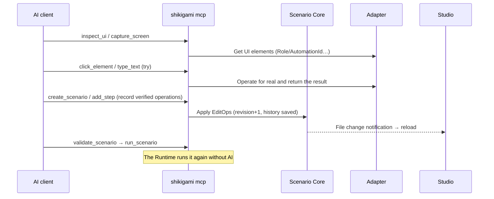

# Shikigami architecture

English | [日本語](ja/architecture.md)

> MCP-native desktop RPA. AI and people create, edit, run and maintain **the same scenarios**.
>
> This document is the reference design. For what is implemented, see [§13](#13-implementation-status-and-limits). Library research: [research.md](research.md) (Japanese).

## 0. Design principles

1. **Scenario Core is the only data layer for scenarios.** The GUI, MCP, CLI and Runtime read and write scenarios only through Core's API (`ScenarioService`). Scenario logic is never implemented twice.
2. **Every change is an EditOp.** Changes are sequences of `EditOp`s that have inverses. Undo/Redo, conflict detection, history and showing AI fixes as diffs are all built on this.
3. **Running needs neither AI nor GUI.** The Runtime is a headless library used by the CLI, Studio and the MCP server alike.
4. **Local first.** Data lives in a local workspace (files), with no dependence on a cloud.
5. **Start small.** No microservices. Processes are split only where technically required (MCP's stdio, Playwright's Node.js).
6. **Windows only.** The product targets Windows 10/11 (x64) only. No macOS / Linux distribution, OS abstraction or testing ([decision 9](#decision-9-windows-only-no-os-abstraction-layer)).

## 1. System architecture

```mermaid
flowchart LR
  subgraph clients[AI clients]
    CC[Claude Code]
    CX[Codex]
    CU[Cursor]
  end

  subgraph local[The user's PC]
    MCP["shikigami mcp<br/>(Rust, stdio)"]
    STUDIO["Shikigami Studio<br/>(Tauri 2 + React)"]
    CLI["shikigami CLI"]

    subgraph libs[Shared libraries (Rust)]
      CORE["shikigami-core<br/>Scenario Core"]
      RT["shikigami-runtime<br/>RPA Runtime"]
      WIN["shikigami-adapter-windows<br/>(UIA, dedicated MTA thread)"]
      BRC["shikigami-adapter-browser<br/>(client of a Node child process)"]
    end

    NODE["browser-adapter<br/>(Node.js + Playwright)"]
    WS[("Workspace<br/>scenarios/*.json<br/>history/ runs/<br/>shikigami.db")]
  end

  CC & CX & CU -- MCP stdio --> MCP
  MCP --> CORE & RT
  STUDIO --> CORE & RT
  CLI --> CORE & RT
  RT --> WIN & BRC
  BRC -- "JSON-RPC (stdio)" --> NODE
  CORE <--> WS
  RT --> WS
  STUDIO -. file watching .-> WS
```

### Process model

| Process | Started by | Role |
|---|---|---|
| `shikigami-studio` | The user | GUI. Embeds Core/Runtime as libraries |
| `shikigami mcp` | The AI client (stdio child process) | Provides the MCP tools. Runs on its own, without a GUI. A subcommand of the CLI executable (so there is one thing to distribute) |
| `shikigami` (CLI) | The user / a scheduler | Headless runs and management |
| `browser-adapter` (Node) | The Runtime | Playwright operations. Started only when needed |

Studio and the MCP server are **separate processes sharing the same workspace**. They stay in sync with §7's "optimistic concurrency with the files as the source of truth, plus change notifications".

### Flow: AI building a scenario (the flow of §6)



**AI operations (exploring) and saving the scenario are separate tools.** UI tools such as `click_element` never change the scenario. To keep a node, the AI calls `add_step` explicitly.

## 2. Monorepo layout

```text
shikigami/
├─ Cargo.toml                 Rust workspace
├─ package.json               pnpm workspace (scripts only)
├─ pnpm-workspace.yaml
├─ crates/
│  ├─ shikigami-core/         Scenario Core (model, expressions, validation, EditOp, history, storage, schema output)
│  ├─ shikigami-runtime/      RPA Runtime (interpreter, handler interface, run records)
│  ├─ shikigami-cli/          CLI (the `shikigami` binary)
│  ├─ shikigami-mcp/          MCP server (rmcp, started with `shikigami mcp`)
│  ├─ shikigami-adapter-browser/  [Phase 3] client of the Node sidecar
│  ├─ shikigami-desktop/  [Phase 4] desktop.* (UI Automation)
│  ├─ shikigami-excel/    excel.* (reads and writes xlsx directly; macros through COM)
│  ├─ shikigami-word/     word.* (fills and reads docx)
│  ├─ shikigami-mail/     mail.* (Outlook: drafts, listing, saving attachments)
│  ├─ shikigami-com/      Office COM calls (shared by Excel macros and Outlook)
│  ├─ shikigami-files/    file.* (text, CSV, copy/move/delete, zip)
│  ├─ shikigami-system/   http.* / process.* / clipboard.* / dialog.*
│  ├─ shikigami-pdf/      pdf.readText (reads the text of PDFs)
│  └─ shikigami-plugins/  node plugins (declared in a manifest, run in a separate process)
├─ apps/
│  └─ studio/                 Tauri 2 + React (src/ is the frontend, src-tauri/ the Rust side)
├─ packages/
│  ├─ schema/                 @shikigami/schema: TS types generated from Rust
│  └─ browser-adapter/        [Phase 3] Node.js + Playwright
├─ plugins/shikigami/        Claude Code plugin (MCP settings + skill)
├─ schemas/                   Generated JSON Schema (committed; CI detects drift)
├─ examples/                  Sample scenarios (also used in tests)
└─ docs/                      Design, research, assets
```

**How types flow:** Rust types → (`schemars`) → `schemas/*.schema.json` → (`json-schema-to-typescript`) → `packages/schema/src/generated.ts`. CI detects drift between Rust and TS both in a Rust test (`committed_schemas_are_up_to_date`) and a TS test (`generated types match`).

## 3. Rust workspace

| Crate | Depends on | Main public API |
|---|---|---|
| `shikigami-core` | serde, schemars, jsonschema, uuid, time, tempfile | `Scenario`, `Step`, `EditOp`, `ScenarioService`, `FileStore`, `Validator`, `StepRegistry`, `expr` |
| `shikigami-runtime` | core, tokio, tokio-util | `Runtime`, `RuntimeBuilder::register`, `ActionHandler`, `RunHandle`, `RunEvent`, `record::*` |
| `shikigami-cli` | core, runtime, mcp, clap | `shikigami scenario/run/validate/step-types/schema/mcp` |
| `shikigami-studio` | core, runtime, tauri, notify | Tauri commands (§7.1) |
| `shikigami-mcp` | core, runtime, rmcp | `ShikigamiMcp` (MCP tools, §6), `serve_stdio` |
| `shikigami-adapter-*` (P3/P4) | runtime | Pairs of `StepTypeDef` + `ActionHandler` |

Dependencies go one way: **core ← runtime ← adapters ← (studio | mcp | cli)**. Core depends on neither tokio nor Tauri (a synchronous API usable from anywhere).

Code quality rules: `unsafe_code = "forbid"` (locally allowed only in the Windows adapter), `clippy::unwrap_used/expect_used/panic = warn` (`-D warnings` in CI).

## 4. Scenario schema

The canonical format is JSON (`schemas/scenario.schema.json`). Example: [examples/invoice-summary.json](../examples/invoice-summary.json).

```jsonc
{
  "schemaVersion": 2,             // file format version
  "id": "scn_…",                  // stable ID (also the file name)
  "name": "Invoice summary",
  "description": "…",
  "requires": { "plugin:kintone": "^0.3.1" },  // plugins used and their versions (managed by Core; omitted when none)
  "revision": 12,                 // +1 on every change; used to detect conflicts
  "variables": [
    { "name": "invoices", "type": "array", "direction": "input", "default": [] },
    { "name": "password", "type": "string", "direction": "input", "secret": true }
  ],
  "steps": [
    { "id": "stp_…", "type": "control.forEach",
      "params": { "items": "invoices", "itemVar": "invoice" },
      "blocks": { "body": [
        { "id": "stp_…", "type": "browser.fill",
          "params": { "target": { "role": "textbox", "name": "Invoice number" }, "value": "{{ invoice.no }}" },
          "retry": { "maxAttempts": 3 }, "timeoutMs": 10000, "onError": "fail" }
      ] } }
  ],
  "settings": { "defaultTimeoutMs": 30000, "onError": "fail" },
  "metadata": { "createdAt": "…", "updatedAt": "…", "tags": ["accounting"] }
}
```

### Key points

- **Nodes are `steps` in the file.** Studio and these docs call each item of a scenario a node; the scenario file and the MCP tools keep the name `step` (`steps`, `stepId`, `add_step`, `StepRegistry`).
- **Every node has the same shape** (`id` / `type` / `params` / `blocks` / common options). Control flow is a tree, with named child lists in `blocks`.
- **Nodes are always referenced by stable ID.** Positions (indexes) are never used as references, so adding, removing or moving nodes does not break other references. IDs are `stp_` + UUIDv7.
- **`params` are validated with a JSON Schema per type** (held by `StepRegistry`). New node types can be added without changing the scenario schema itself.
- **Expression language** (§11 decision 5): conditions are expressions (`count > 3 && status == 'OK'`), string params are `{{ expression }}` templates. No arbitrary code can run.
- **Common node options**: `disabled`, `timeoutMs`, `retry`, `onError` (`fail`/`continue`), `saveAs` (output into a variable), `meta` (for Studio display and the AI's evidence; the Runtime ignores it).
- **Backward compatibility**: on load, `schemaVersion` drives step-by-step migration (`migrate.rs`). Future versions are rejected with `UNSUPPORTED_SCHEMA_VERSION` rather than silently truncated. Unknown keys in `metadata` are kept. When the version goes up, plugin `requires`, deprecation, and MCP / CLI compatibility: [compatibility.md](compatibility.md).
- **YAML** is a possible future import/export format, not the canonical one.

### Built-in node types (Phase 1)

| type | Contents |
|---|---|
| `control.if` | `condition` / blocks: `then`, `else` |
| `control.while` | `condition`, `maxIterations` (default 1000) / `body` |
| `control.repeat` | `count`, `indexVar` / `body` |
| `control.forEach` | `items` (expression), `itemVar`, `indexVar`, `collect` (expression; each iteration's value is returned in `saveAs` as a list), `concurrency` (how many run at once) / `body` |
| `control.parallel` / `control.group` | Run in parallel (§10.5) / group several steps into one branch |
| `wait.until` | `condition` (expression), `intervalMs` / `check`. Waits until the condition is true. Limited by `timeoutMs`; past it, `WAIT_TIMEOUT` |
| `control.try` | `errorVar` / `try`, `catch`, `finally` |
| `control.break` / `control.continue` | Loop control (a validation error outside a loop) |
| `control.fail` | Fails with `message`, `code` |
| `variable.set` | Assigns `value` (templates allowed) or `expression` to `name` |
| `log.message` | Writes to the run log |
| `scenario.call` | Calls another scenario as one node, with `scenario` (ID), `inputs`, `outputs` ([design](design/subscenarios.md), Japanese) |
| `flow.delay` | Waits for a fixed time (use `wait.until` to wait for something to finish) |

## 5. Adapter interface

An adapter registers pairs of **node type definition (metadata) + handler (execution)** with the Runtime.

```rust
pub trait ActionHandler: Send + Sync + 'static {
    fn execute<'a>(&'a self, input: ActionInput) -> BoxFuture<'a, Result<Value, StepError>>;
}
// ActionInput: run_id, step_id, step_type, attempt, params (templates expanded), cancel (CancellationToken), log()
// StepError:   code, message, details, retryable

Runtime::builder()
    .register(browser::click_def(), browser::Click::new(client.clone()))
    .register(windows::invoke_def(), windows::Invoke::new(uia.clone()))
    .build();
```

- Handlers **never touch scenario variables directly**. Input is the expanded `params`; output is the return value (into a variable with `saveAs`). Adapters do not depend on scenario state, so they are easy to unit test.
- Timeouts, retries, cancellation and `onError` are handled uniformly by the Runtime. Handlers watch `cancel` to stop long work.
- `StepError::retryable=false` (e.g. invalid params) is not retried.
- Evidence on failure (UI element snapshot, screenshot path, expected and actual state) goes in `StepError.details`, so the AI can get it from run records and MCP (§8 / §6).

### Choosing elements (Target)

Semantic information first; coordinates as a fallback.

```jsonc
// Browser
{ "role": "button", "name": "Log in" }            // first choice (accessibility)
{ "label": "Email" } | { "text": "Send" } | { "testId": "submit" }
{ "css": "…" }                                     // last resort
// Windows
{ "window": { "title": "Billing", "process": "billing.exe" },
  "automationId": "btnSave", "name": "Save", "controlType": "Button" }
{ "point": { "x": 120, "y": 340 }, "relativeTo": "window" }   // fallback (validation warns)
```

### 4.1 Windows adapter

- Uses IUIAutomation directly through the `windows` crate. The `uiautomation` crate has a single maintainer, so it is a reference only, not a dependency.
- `CoInitializeEx(COINIT_MULTITHREADED)` on a **dedicated worker thread** (with no window). Every UIA call goes through a request queue to this thread (Microsoft's recommendation).
- Elements are held only within a request; raw pointers never leave the thread. Scenarios store only Targets (semantic information), resolved again on every run.
- `IUIAutomation2` connection and transaction timeouts protect against hung apps. Privilege differences (an elevated app cannot be operated from a non-elevated process) give the dedicated error `ELEVATION_REQUIRED`.
- **Implemented** ([desktop.md](desktop.md)): crate `shikigami-desktop`, 11 `desktop.*` node types, MCP's `inspect_ui`. Nodes are one set regardless of the app's technology (Win32 / WPF / SAP GUI / Java); how to grab elements is chosen from the window automatically (currently UI Automation only; SAP GUI and Java windows are detected and noted).

### 4.2 Browser adapter

- Starts Node.js + Playwright as a **child process** and talks newline-delimited JSON-RPC 2.0 over stdin/stdout (§7.3).
- Waiting uses Playwright's auto-waiting / `locator.waitFor` / `page.waitForLoadState`, never fixed sleeps.
- The Rust side detects a crashed child process, fails the running node with `ADAPTER_CRASHED`, and restarts it on the next request.
- **Implemented** ([browser.md](browser.md)): crate `shikigami-browser` (child process management, 10 `browser.*` nodes), `packages/browser-adapter` (runs TypeScript directly on Node 22.18+). The browser is Edge by default on Windows and is not bundled. Pages are split into one BrowserContext per "run × `context` name" and closed when the run ends.

## 6. MCP tool interface (Phase 2)

> **Status**: the scenario, node and run tools (except the UI tools and `debug_scenario` / `test_step`) are implemented. `get_history`, `list_runs` and `undo` / `redo` were added, and run logs are `get_run_logs(runId, afterSeq?)`. Usage and per-client settings: [mcp.md](mcp.md). The UI tools are Phase 3 / 4.

Every tool is a thin layer that only calls Core / Runtime / adapters. Input schemas are generated from Rust types; output is structured JSON (`structuredContent`). Errors are §9's `ErrorPayload` as is.

| Class | Tool | Main input → output | Permission class |
|---|---|---|---|
| Scenarios | `list_scenarios` | → `ScenarioSummary[]` | read |
|  | `get_scenario` | `id` → `Scenario` | read |
|  | `create_scenario` | `NewScenario` → `EditOutcome` | write |
|  | `update_scenario` | `id, expectedRevision?, patch \| ops[]` → `EditOutcome` | write |
|  | `delete_scenario` | `id, expectedRevision` → ok (to the trash) | write, **needs approval** |
|  | `validate_scenario` | `id \| scenario` → `ValidationReport` | read |
| Nodes | `add_step` / `update_step` / `remove_step` / `move_step` | each `EditOp` + `expectedRevision?` → `EditOutcome` | write |
|  | `list_step_types` | → `StepTypeDef[]` | read |
|  | `get_step_schema` | `type` → params JSON Schema | read |
| UI | `inspect_ui` | target (window/page), depth → element tree (semantic info + suggested Target) | ui.read |
|  | `capture_screen` | target → image (MCP image content) | ui.read |
|  | `click_element` / `type_text` / `select_element` | Target, value → result + state after | ui.act |
|  | `wait_for_element` | Target, state, timeout → result | ui.read |
|  | `launch_application` / `navigate_browser` | path, URL → result | ui.act, allowlist |
| Runs | `run_scenario` | `id, inputs` → `runId` | run |
|  | `stop_scenario` | `runId` → ok | run |
|  | `get_run_status` | `runId` → `RunSnapshot \| RunReport` | read |
|  | `get_run_logs` | `runId, afterSeq?, variable?` → `RunEventEnvelope[]` | read |
|  | `debug_scenario` | `id, breakpoints[]` → `runId` (step through) | run |
|  | `test_step` | `Step` (single), variables → result (does not change the scenario) | ui.act |

- **Write tools accept `expectedRevision`.** Without it the edit applies to the latest revision (convenient for AI); with it, a conflict gives `REVISION_CONFLICT`.
- **`update_scenario` also accepts an ops array** (several changes applied atomically as one revision).
- Repair proposals (Phase 6) go `propose_fix` (saves an ops array as a proposal) → user approval → `apply_proposal`. They are never applied directly (§8).
- The bundled **Claude Code plugin** (MCP settings + skill `SKILL.md`) teaches the AI the practice "look at the UI → use semantic Targets → validate → confirm with a run without AI".

## 7. IPC

### 7.1 Studio (Tauri commands / events)

The frontend calls Rust commands with `invoke` from `@tauri-apps/api`. Command names and arguments are typed in one place, `apps/studio/src/lib/api.ts`.

| Command | Core / Runtime API |
|---|---|
| `list_scenarios`, `get_scenario`, `create_scenario`, `duplicate_scenario`, `delete_scenario` | `ScenarioService::{list,get,create,duplicate,delete}` |
| `edit_scenario(id, expectedRevision, ops)` | `ScenarioService::edit` |
| `undo`, `redo`, `undo_state` | `ScenarioService::{undo,redo,undo_state}` |
| `validate_scenario`, `list_step_types`, `scenario_history` | The API of the same name |
| `run_scenario`, `stop_run`, `run_status` | `Runtime::start`, `RunHandle::cancel`, `RunSnapshot` |

Events: `scenario-changed { scenarioId }` (file watching, including changes by other processes), `run-event` (`RunEventEnvelope`).

### 7.2 Scenario sync between processes (Studio ⇔ MCP ⇔ CLI)

- The workspace files are the source of truth. Every change goes "exclusive lock (`.lock`) → reload → check `revision` → apply → write a temporary file and rename". Readers never see half-written files.
- Change notifications use OS file watching (`notify`). Studio reloads from Core on a notification and, if the scenario is open, swaps it in and says it picked up an outside change.
- Studio's edits always carry `expectedRevision`. If the AI changed it first, `REVISION_CONFLICT` → reload automatically and tell the user (never overwrite).
- The Undo/Redo stack is saved per scenario in the workspace (`history/<id>/undo.json`), so **AI changes can be undone from Studio**. The stack records the `revision` it belongs to and is discarded if an outside change such as `git checkout` makes it inconsistent.

### 7.3 Runtime ⇔ browser adapter (Phase 3)

- Newline-delimited JSON-RPC 2.0 over stdio. Request: `{"jsonrpc":"2.0","id":1,"method":"click","params":{...}}`.
- Methods (implemented): `open`, `click`, `fill`, `select`, `press`, `getText`, `getTable`, `waitFor`, `screenshot`, `snapshot` (accessibility tree), `close`, `closeRun`, `ping`, `shutdown`. `download` / `upload` are not implemented.
- A heartbeat (`ping`) and child process exit monitoring detect crashes. stderr is forwarded to tracing.
- The protocol types are also generated into `@shikigami/schema` and shared by Rust and TS.

### 7.4 MCP (Phase 2)

- **stdio** by default (the AI client starts it as a child process; no port is opened).
- Optionally Streamable HTTP (127.0.0.1 only, a token generated at startup required, Origin checked).

## 8. Database

**Scenarios are JSON files; operational data goes in SQLite** (§11 decision 3). In Phase 1 run records are files (JSONL) too. SQLite comes in Phase 2 to speed up search and listing and for the audit log, as an index over the files, which stay the source of truth.

Workspace layout:

In a shared workspace, `history/` and `runs/` are kept on each PC ([design/sharing-versioning.md](design/sharing-versioning.md), Japanese).

```text
<workspace>/            default: SHIKIGAMI_HOME > workspace in config.json > %APPDATA%\Shikigami\workspace
  workspace.json        optional. {"shared": true} makes it a shared workspace
  scenarios/<id>.json   scenarios (source of truth)
  versions/<id>/<n>.json  named versions (immutable snapshots)
  history/<id>/journal.jsonl  change journal (append-only, audit)
  history/<id>/undo.json      Undo/Redo stack
  runs/<run-id>/events.jsonl  run events (secrets masked)
  runs/<run-id>/report.json   run result
  runs/<run-id>/artifacts/    screenshots etc. (Phase 3 on)
  trash/                      deleted scenarios
  shikigami.db                SQLite (Phase 2 on)
```

`events.jsonl` also records variable assignments as `variableChanged`, so after a run you can trace which value went into which variable, and when and in which node it changed (MCP: `get_run_logs(runId, variable)`, CLI: `shikigami run --vars`).

```json
{ "seq": 7, "at": "…", "runId": "run_…", "type": "variableChanged",
  "variable": "amount", "value": 13200, "stepId": "stp_…", "iteration": 0 }
```

- `stepId`: the node that assigned it (`variable.set`, `saveAs`, `forEach` / `repeat` item and index variables, `errorVar` / `lastError`). Inputs and defaults appear right after `runStarted` without a `stepId`.
- `iteration`: present only on changes inside a parallel `forEach` (with `concurrency`), the element number (from 0), to tell concurrent iterations apart.
- Variables with `secret: true` have the value `"***"`. Secret values that slipped into other variables are masked too.
- Values over 1000 characters are cut to a preview with `truncated: true` (the start of strings; the start of the JSON text for lists and objects).
- Changes in each `parallel` branch are emitted when they happen in the branch, not again when the branches join. The order is that of `seq`.

SQLite schema (planned for Phase 2):

```sql
CREATE TABLE runs (
  run_id TEXT PRIMARY KEY, scenario_id TEXT NOT NULL, scenario_revision INTEGER NOT NULL,
  status TEXT NOT NULL, started_at TEXT NOT NULL, finished_at TEXT,
  error_code TEXT, error_step_id TEXT, trigger TEXT NOT NULL  -- studio | mcp | cli | schedule
);
CREATE INDEX runs_by_scenario ON runs(scenario_id, started_at DESC);

CREATE TABLE run_failures (               -- for AI error analysis (§8 requirement)
  run_id TEXT PRIMARY KEY REFERENCES runs(run_id),
  step_id TEXT NOT NULL, error_code TEXT NOT NULL, message TEXT NOT NULL,
  ui_snapshot_path TEXT, screenshot_path TEXT, expected_state TEXT, actual_state TEXT
);

CREATE TABLE audit_log (                  -- audit (MCP tool calls, approvals, runs)
  id INTEGER PRIMARY KEY, at TEXT NOT NULL, actor_kind TEXT NOT NULL, actor_name TEXT,
  action TEXT NOT NULL, target TEXT, decision TEXT, details TEXT
);

CREATE TABLE proposals (                  -- AI repair proposals (applied after approval)
  id TEXT PRIMARY KEY, scenario_id TEXT NOT NULL, base_revision INTEGER NOT NULL,
  ops TEXT NOT NULL, rationale TEXT, status TEXT NOT NULL,  -- pending | applied | rejected
  created_at TEXT NOT NULL, decided_at TEXT
);

-- Secrets (login details) are not in the DB but encrypted under <workspace>/secrets/ (docs/secrets.md)
```

## 9. Errors

- Every error is a **stable code (SCREAMING_SNAKE_CASE) + English message + structured details**. The UI localizes by code.
- One wire format: `ErrorPayload { code, message, details? }` (shared by Tauri / MCP / CLI).

| Layer | Type | Typical codes |
|---|---|---|
| Core | `CoreError` | `SCENARIO_NOT_FOUND`, `REVISION_CONFLICT`, `VALIDATION_FAILED`, `STEP_NOT_FOUND`, `DUPLICATE_STEP_ID`, `INVALID_EDIT`, `UNSUPPORTED_SCHEMA_VERSION`, `STORAGE_ERROR` |
| Validation | `ValidationIssue` (error / warning, with JSON Pointer) | `UNKNOWN_STEP_TYPE`, `INVALID_PARAMS`, `EXPR_SYNTAX`, `UNKNOWN_BLOCK`, `NOT_IN_LOOP`, `UNDEFINED_VARIABLE` (warning) |
| Expressions | `ExprError` | `EXPR_SYNTAX`, `EXPR_UNDEFINED_VARIABLE`, `EXPR_UNKNOWN_FUNCTION`, `EXPR_TYPE` |
| Runtime | `RunError { code, message, stepId, stepType, details }` | `STEP_TIMEOUT`, `RUN_CANCELLED`, `LOOP_LIMIT_EXCEEDED`, `MISSING_INPUT`, `INVALID_INPUT`, `UNSUPPORTED_STEP_TYPE` |
| Adapter | `StepError { code, message, details, retryable }` | `ELEMENT_NOT_FOUND`, `ELEMENT_NOT_INTERACTABLE`, `NAVIGATION_FAILED`, `ADAPTER_CRASHED`, `ELEVATION_REQUIRED`, `APP_NOT_ALLOWED` |

- **Validation reports everything.** It does not stop at the first error, so Studio and the AI can fix it all at once.
- **Drafts are allowed**: incomplete scenarios mid-edit (an `if` without a condition, etc.) can be saved. **Structural breakage** such as duplicate or invalid IDs is rejected. Runs do not start while there are validation errors.
- On failure, the failing node ID, type, code, message and details are always kept in `RunReport` and the events. `control.try`'s `errorVar` and `onError: continue`'s `lastError` get the same structure.
- Inside Rust, no `unwrap` / `panic`; errors propagate as `Result` (clippy warns, CI rejects).

## 10. Security

| Threat / requirement | Measure | When |
|---|---|---|
| Arbitrary code execution | Scenarios have no general script execution. The expression language allows only side-effect-free functions (`len`, `contains`…). Nesting depth limits prevent DoS too | **P1 done** |
| Path traversal | Scenario/run IDs accept only `[A-Za-z0-9_-]{1,128}`, checked before use as file names | **P1 done** |
| Secrets in logs | Values of `secret` variables and secrets are masked as `***` in logs, errors, events and output records. Password fields are blacked out in screenshots and removed from page information returned to AI | **Done** |
| Irreversible mistakes | Deleting a scenario moves it to the trash. Every change is journaled and can be undone | **P1 done** |
| Studio permissions | Tauri capabilities are `core:default` only. No file or shell plugins. CSP set | **P1 done** |
| MCP access control | stdio by default (only the AI client that started it can connect). HTTP is localhost + token + Origin check | P2 |
| Tool permissions | Tools are classed as `read / write / run / ui.read / ui.act / dangerous` and allowed per client in workspace settings. `dangerous` (deletion, file operations, starting apps outside the allowlist) needs user approval in Studio | P2 |
| Allowlist of targets | `launch_application` / `navigate_browser` only for the allowlist in settings (executable paths, domains). The Runtime checks the same list when running | P2–P4 |
| File operation limits | File nodes only under directories allowed in workspace settings | P3 |
| Credentials | People register them by name in Studio / the CLI. Values are encrypted with AES-256-GCM in the workspace; the key is one entry per workspace in Windows Credential Manager. Scenarios and AI get only the name. Input to unregistered sites is refused. Sign-in states (sessions) are encrypted with the same key ([secrets.md](secrets.md)) | **Done** |
| Prompt injection | Results such as `inspect_ui` and page text are returned as structured data clearly labeled "untrusted data", and SKILL / tool descriptions say not to treat them as instructions. UI tools do not change scenarios; saving is a separate operation. Dangerous operations need human approval | P2 |
| Audit | Every MCP tool call, approval and run in `audit_log` (scenario changes are journaled since P1) | P2 |
| Run permissions | Per scenario: "may run from MCP", "may run unattended" | P2 |

## 10.5 Parallel execution

Running several things at once is meant to be a feature of the product. There are three levels.

| Level | Contents | Status |
|---|---|---|
| Between scenarios | Several scenarios (including several runs of the same one) at once. Each run is an independent async task with its own variables, cancellation and records | **Implemented** (call the Runtime / MCP `run_scenario` several times) |
| Within a scenario | `control.parallel` (runs each node of `branches` at once and waits for all; if one fails the rest are cancelled; `maxConcurrency` limits how many). Wrap multi-step branches in `control.group` | **Implemented** |
| Within a scenario (loops) | `control.forEach`'s `concurrency` ("100 items, 5 at a time"). Each iteration works on a copy of the variables; only the `collect` value comes out (in `saveAs`, as a list in the order of `items`). Aggregate after the loop, e.g. `sum(results)`. The first failure cancels the rest, with the item number in the error's `details.index` | **Implemented** |
| Resource arbitration | Node type definitions (`StepTypeDef.resources`) declare which params point at resources. The Runtime builds resource keys (`desktop.input`, `file:c:\data\book.xlsx`, `window:…`, `browser:…`) from the params after template expansion and never runs nodes with the same key at once. People and AI writing scenarios never write lock names. File paths are normalized (case, `/`, `.`/`..`, `\\?\`) to the same key; relative paths give the `RELATIVE_PATH` warning. `desktop.input` is exclusive, browsers are parallel per context, data processing is unlimited | **Implemented (within one process)**. Exclusion between processes (Studio, CLI, MCP server) comes in Phase 4 with Windows named mutexes |

- **Desktop operations are physically one set**: Windows has only one mouse/keyboard input (SendInput) and one foreground window, so nodes using them take the `desktop.input` right before running (time spent waiting for it does not count toward the timeout). Many UI Automation pattern operations (Invoke / Value / SelectionItem…) need no focus, so each type declares whether it can run in parallel without the right (implemented: `desktop.click` / `setValue` etc. do not take it; `desktop.mouseClick` / `type` / `press` do; all go one at a time to the same app, `window:<process>`).
- **Browsers suit parallel work**: Playwright browser contexts are independent, and many can run at once headless (Phase 3).
- **Variables**: each branch works on a copy of the variables at its start; after all branches finish, the variables each branch changed are written back in branch order. If two branches change the same variable to different values, it fails with `PARALLEL_VARIABLE_CONFLICT` (so results never depend on timing). Two or more branches writing the same variable is also `PARALLEL_VARIABLE_CONFLICT` in validation before the run. `break` / `continue` from a branch to an outer loop is a validation error (`NOT_IN_LOOP`).
- **Validating parallel forEach**: writing to declared variables in the body (`FOREACH_SHARED_WRITE`) and `break` (`FOREACH_BREAK_IN_CONCURRENT`) are errors; variables updated from their own value (`total = total + x`, `FOREACH_ACCUMULATOR`) and `collect` without `saveAs` are warnings. All come with hints for fixing them.
- **Waiting**: there is no dedicated construct for waiting on slow work (such as copying into Excel). It is expressed with two things: waiting for `control.parallel` branches, and `wait.until` (polling a state). No extra constructs, so the AI does not have to choose between them ([design/ai-authoring.md](design/ai-authoring.md), Japanese).
- **Driving more desktops** needs several Windows sessions (RDP / virtual machines). That is a future "worker" feature, outside the MVP.

## 11. Key design decisions (reasons, alternatives, trade-offs)

### Decision 1: scenarios are a node tree (block structure)

- **Reason**: easy for AI to read and write (JSON nesting is the processing structure), easy to validate (is a break inside a loop?). References are by ID, so edits do not break them. Flowcharts are drawn from the tree with automatic layout.
- **Alternative**: a graph of nodes and edges (BPMN-like). Any branching and joining can be written.
- **Trade-off**: arbitrary goto-like jumps cannot be expressed. Control is limited to structured forms (if / loop / try / break / continue), which keeps scenarios maintainable. If a graph is ever needed, a tree converts to a graph.

### Decision 2: Studio and MCP sync by optimistic concurrency with the files as the source of truth

- **Reason**: the MCP server is a separate process started over stdio by the AI client, and must work without a GUI. Without a shared daemon, a lock + revision check + atomic writes + file watching are enough for two-way editing. It also works well with diffs in git.
- **Alternative A**: embed the MCP server in Studio → a GUI becomes required, against the requirements.
- **Alternative B**: a resident daemon (local RPC) as the source of truth, with Studio/MCP as its clients → stronger consistency, but more process management, start order and authentication.
- **Trade-off**: file watching has latency (hundreds of ms), and listing many scenarios scans files. Concurrent edits are not "last write wins" but "detect the conflict → reload", which is safe. All access is confined to `ScenarioService` so that a move to B for multiple users or remote management stays possible.

### Decision 3: scenarios as JSON files, operational data in SQLite

- **Reason**: scenarios should be readable text that people, AI and git handle directly. Run history and audit logs grow and need searching, which suits a DB.
- **Alternative**: everything in SQLite. Transactions get simpler, but reviewing scenario diffs, sharing and backup get harder.
- **Trade-off**: two kinds of persistence. Phase 1 starts with files only; SQLite comes when needed (Phase 2).

### Decision 4: every edit is an EditOp with an inverse

- **Reason**: Undo/Redo, conflict detection, history, showing AI fixes as diffs and applying them after approval all come from one mechanism. MCP's `add_step` and the like map directly to EditOps.
- **Alternative**: history as snapshot diffs (JSON Patch). General, but loses meaning ("moved a node"), making review harder for AI and people.
- **Trade-off**: every new kind of edit needs an inverse and tests (round-trip tests exist for every op).

### Decision 5: our own expression language

- **Reason**: conditions and templates must be writable without allowing arbitrary code. The candidate evalexpr had moved to AGPL. What is needed is small (comparison, logic, arithmetic, path access, a few pure functions).
- **Alternative**: embed a JavaScript engine (QuickJS / Boa) or a scripting language such as Rhai. More expressive, but heavy on sandbox design, dependency size and security review.
- **Trade-off**: advanced transformations cannot be written. When needed, individual allowlisted "data transformation nodes" are added.

### Decision 6: Rust types are the only source of type definitions

- **Reason**: Core is the canonical data layer, so the types live in Core. schemars produces JSON Schema, from which TS types are generated.
- **Alternative**: hand-written JSON Schema generating both Rust and TS (typify etc.), or generating TS directly with ts-rs / specta.
- **Trade-off**: some generated TS types are redundant (duplicate names like `Position1`). Consistency over readability. CI detects drift in generated files.

### Decision 7: the Runtime is an interpreter that walks the tree directly

- **Reason**: node IDs in run events match the scenario being edited one to one, which keeps highlighting and debugging in Studio and AI error analysis simple.
- **Alternative**: compile to bytecode / a state machine. Better for pausing and resuming (persistence).
- **Trade-off**: long runs cannot currently resume midway (after a crash). If needed, it can be extended by recording the run position (a stack of node IDs).

### Decision 8: the browser adapter is a Node.js child process

- **Reason**: the official Playwright (Node.js) is the most mature and was preferred in the requirements. Process isolation keeps a Node crash from taking down the Runtime.
- **Alternative**: drive CDP directly from Rust (chromiumoxide etc.). A single binary, but it would mean re-implementing the quality of Playwright's auto-waiting and locators.
- **Trade-off**: bundling Node.js grows the distribution. The installer carries `node.exe` and the adapter; the browser is Windows' Edge ([release.md](release.md#bundling-nodejs-and-the-browser-adapter)).

### Decision 9: Windows only (no OS abstraction layer)

- **Reason**: business RPA in Japan targets almost entirely Windows business apps and browsers. Narrowing the target lets us use Windows features freely (Credential Manager / DPAPI, unattended runs through Task Scheduler, an inspector built on UI Automation) and lowers the cost of testing, distribution and support.
- **Alternative**: also target macOS / Linux and abstract desktop operations behind a common OS interface.
- **Trade-off**: no answer for demand on other OSes. Core / Runtime / the MCP server being OS-independent is not "for a future port" but for reasons a Windows-only product still needs: running without a GUI, isolating UIA on its dedicated thread, and fast tests. Linux CI is used only to run core tests quickly and cheaply, not as a product target. Distribution is NSIS / MSI only.

## 12. MVP acceptance criteria

The first product milestone: **create a web scenario from an MCP client in natural language, check and edit it in the GUI, then run the same work again with the Runtime and no AI.**

| # | Criterion | How it is checked |
|---|---|---|
| A1 | Claude Code / Codex connect to `shikigami mcp` over stdio and get the tool list | Manual E2E (settings for each client in the docs) |
| A2 | The AI gets elements with `navigate_browser` → `inspect_ui` and can `click_element` / `type_text` with Role/Label Targets | Automated E2E (a local test web app) + manual |
| A3 | The AI saves a scenario with `create_scenario` / `add_step` and `validate_scenario` returns 0 errors | Automated E2E |
| A4 | With Studio running, AI changes show up on screen within 1 second | Automated (file watching test) + manual |
| A5 | Studio can edit, add, delete and move nodes, with Undo/Redo, and MCP's `get_scenario` returns the result immediately | Automated (Core tests) + manual |
| A6 | Nothing is lost when Studio and the AI edit at the same time (conflicts are detected and reloaded) | Automated (Core tests) |
| A7 | `shikigami run <id>` (no AI, no GUI) does the same web work successfully, exit code 0 | Automated E2E |
| A8 | On failure, the failing node ID, error code, screenshot and UI information are saved and available from MCP's `get_run_logs` | Automated E2E |
| A9 | Secret variable values never appear in logs or record files | Automated |
| A10 | On **a real Windows 11 machine**, A1–A9 E2E pass with Studio / CLI / MCP server installed from the installer (NSIS / MSI) | Manual E2E (required) + CI (build and test on windows-latest) |

## 13. Implementation status and limits

### Implemented (with tests)

- Rust workspace, pnpm workspace, CI (fmt, clippy, test on Linux / Windows; TS typecheck, tests, generated-file drift)
- Scenario Core: model, JSON Schema output, validation (reports everything, JSON Pointer), expression language, EditOp (inverses for every kind), Undo/Redo (persistent, shared between processes), change journal, file store (lock, atomic writes, revision conflict detection), schema version migration framework
- Runtime: every kind of control flow, variables and inputs/outputs, template expansion, timeouts, retries (exponential backoff), cancellation, `onError`, secret masking, run events and records (JSONL), live state (snapshots)
- CLI: `scenario list/show/create/import/edit/undo/redo/delete/history`, `run` (inputs, JSON output, Ctrl+C cancels), `validate`, `step-types`, `schema export`
- Studio (Tauri 2 + React): scenario list, create, duplicate, delete; flowchart (automatic layout from the tree); add, delete and move nodes; property forms generated from schemas; variable editing; validation results; Undo/Redo (Ctrl+Z / Ctrl+Y); run, stop, run log and node state highlighting; **live updates from outside changes (MCP / CLI)**; automatic reload on conflict; Japanese / English UI
- MCP server (Phase 2): `shikigami mcp` (stdio), 20 tools for scenarios, nodes, validation, history, Undo/Redo, runs and logs; structured results and error codes; tool annotations; permission classes limited with `--allow`; audit log (`audit/mcp.jsonl`); client names in the change history. Automated E2E with the rmcp client, and connection from Claude Code CLI confirmed ([mcp.md](mcp.md))
- Desktop apps (Phase 4): 11 `desktop.*` types (dedicated UI Automation MTA thread, automatic waiting, separating mouse-free operations from those taking `desktop.input`, per-app exclusion, secrets typed only into apps registered with `app:`) and MCP's `inspect_ui` ([desktop.md](desktop.md))
- Excel (8 `excel.*` types): reads and writes xlsx / xlsm directly without Excel (read a table row by row, append rows, read and write cells / ranges, list / add sheets). Automatic exclusion by workbook path, saving through a temporary file, `FILE_IN_USE` when writing a workbook open in Excel ([office.md](office.md))
- Claude Code plugin: `plugins/shikigami` (MCP settings + skill `shikigami-scenarios`) and the marketplace definition. Passes `claude plugin validate`

### Not implemented (later phases)

- SAP GUI Scripting, Java Access Bridge and image recognition for Windows; resource exclusion between processes (§10.5); browser downloads and uploads
- Drag-and-drop editing in Studio, breakpoints and stepping, a UI element inspector, diff view (Phase 5)
- SQLite, per-client tool permissions and human approval of deletion, allowlists, credential store integration, MCP's Streamable HTTP

### Known limits

- Undo/Redo is **one stack per scenario shared by all clients** (AI changes can be undone from Studio, but it is not per user).
- Variable scope is flat (loop variables are one per scenario too), like most RPA products.
- `control.try`'s `finally` does not run on cancellation.
- Runs cannot resume midway (after a process restart).
- Studio's flowchart is an automatic display layout; node positions are not saved.
- During development, Studio was started on Linux under Xvfb to check editing, running and live updates (Linux is not a product target). **Starting Studio on a real Windows machine is unconfirmed** (CI confirms build and tests only).
