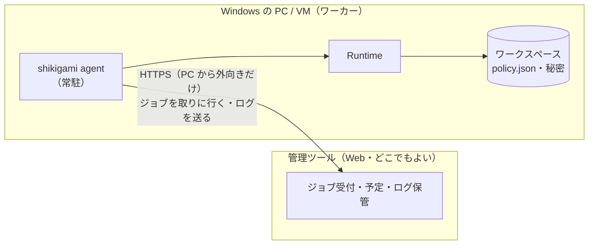

# 離れた所からの実行指示と管理ツール（設計メモ・案）

状態：**案**。実装はまだしない。将来、クラウドの管理ツール（UiPath Orchestrator に当たるもの）を作るときに作り直しにならないよう、いまの設計に入れておく拡張点を決める。

前提として変えないこと：

- **AI が作り、AI なしで動く。** 管理ツールも AI を必要としない。
- **ローカルファースト**（[architecture.md](../architecture.md) §0-4）。管理ツールにつながなくても、今と同じにすべて動く。つなぐのは選んだ人だけ。
- **Windows 特化。** 実行する側（ワーカー）は Windows の PC・VM。管理ツールそのものは Web なので OS を問わない。
- **版の管理は自前**（[sharing-versioning.md](sharing-versioning.md)）。Git にも特定のクラウドにも頼らない。
- **OSS。** PC と管理ツールのあいだの約束（プロトコル）は公開し、誰でも別の管理ツールを作れるようにする。公式の管理ツールは選択肢の一つ。

## 1. いまの設計でどこまで考慮されているか

**離れた所から実行を指示する仕組みは、まだ設計されていない。** 「スケジュール実行」も、実行の入口（`trigger` に `schedule`）とボタンの置き場所（[ui-principles.md](ui-principles.md)）が決まっているだけで、スケジューラ自体はない。今の無人実行は、Windows のタスクスケジューラなどから `shikigami run <id>` を呼ぶ形。

ただ、土台になるものはすでにある。

| すでにあるもの | 管理ツールでの意味 |
|---|---|
| 無人実行は公開版だけ（[policy.md](../policy.md)） | 離れた所からの実行も公開版だけにすれば、AI の作業中の内容が勝手に動くことはない。そのまま使える |
| 版の `uid` と、実行記録の `version` | 「どの版を動かしたか」をワーカーと管理ツールで同じ値で言える |
| `shikigami run --json`（`RunEvent` の行）と終了コードは互換の約束（[compatibility.md](../compatibility.md)） | ワーカーが管理ツールへ送るログの形に、そのまま使える |
| 実行イベントに `seq`、秘密は記録の時点で `***` | 途切れても続きから送り直せる。送る前に伏せ字にする仕組みが要らない |
| `policy.json` の `scenarios.<id>.unattended` | 「このシナリオは無人で動かしてよいか」を PC 側で決める場所がある |
| シナリオへの読み書きは `ScenarioService` だけ（architecture.md 決定 2） | 「複数人・離れた所からの管理に移れるように」とすでに書いてある |
| バンドル（`*.shikigami.json`）と `shikigami run <file>` | 管理ツールからシナリオを配る形に使える |
| 「ワーカー」（複数の Windows セッションでデスクトップを並列に）は将来の機能と明記（architecture.md §10.5） | 管理ツールの「ロボット」に当たる |

足りないもの：

- 実行を頼む側と動かす側を分ける「ジョブ」という考え方がない。実行の入口が Studio・MCP・CLI でばらばらで、誰が・何のために頼んだかが実行記録に残らない（`RunReport` に `trigger` も無い）。
- PC の名前・ワークスペースの識別が実行記録に無い。
- プロセスをまたぐ排他（Studio と CLI が同時にデスクトップを触る）、画面ロックの検知、キャンセル時の `finally`、途中で止まった実行の後始末が未対応（いずれも設計ギャップの「次」）。
- 秘密（ログイン情報）は PC ごと・Windows ユーザーごとの鍵で守られていて、別の PC へは持ち出せない（[secrets.md](../secrets.md)）。これは正しい性質なので、管理ツールでも変えない前提で設計する。

## 2. 全体の形



- PC 側に **`shikigami agent`**（CLI のサブコマンド。配る物は増やさない）を置く。常駐して管理ツールからジョブを受け取り、Runtime で実行し、ログを返す。
- **通信は PC からの外向き HTTPS だけ。** PC にポートを開けない。社内のプロキシ・ファイアウォールの内側でもそのまま動く（ロングポーリングから始め、必要なら WebSocket）。
- **最後に決めるのは PC 側。** 管理ツールが何を頼んでも、PC の `policy.json`（サイト・アプリ・無人実行の可否）と公開版の決まりが優先する。管理ツールが乗っ取られても、PC が許したこと以上は起きない。
- **秘密はクラウドに出さない。** ジョブは秘密の名前しか持たず、値はワーカーの PC で登録したものを使う。

## 3. 今のうちに入れておく拡張点

コストが小さく、後から入れると互換を壊すものを先に入れる。上ほど優先。

### 3.1 実行の入口を「実行の依頼（RunRequest）」に一本化する

Studio の実行・MCP の `run_scenario`・`shikigami run`・将来のスケジュールとエージェントが、同じ構造体で Runtime に頼む。管理ツールは「依頼の出どころが一つ増えるだけ」になる。

```jsonc
{
  "scenarioId": "scn_…",
  "version": { "uid": "019a…" },        // 省略時は公開版。draft: true は人の手元の試しだけ
  "inputs": { "締め日": 25 },
  "trigger": "cli",                      // studio | mcp | cli | schedule | agent
  "requestedBy": { "kind": "person", "name": "…" },
  "jobId": null,                         // 管理ツールのジョブ。ローカルでは null
  "deadline": null                       // 開始の締め切り（過ぎたら動かさない）
}
```

### 3.2 実行記録に「誰が・どこで・何のために」を残す

`RunReport` と `runStarted` に `trigger`・`requestedBy`・`jobId`・`machine`（PC 名とワークスペースの ID）を足す（`schemas/` の契約の追加。足すだけなので互換は保てる）。管理ツールが無くても、「夜のタスクスケジューラの実行か、AI の試しか」を記録で見分けられるようになる。

### 3.3 ワークスペースとワーカーの ID

`workspace.json` にワークスペースの ID（作ったときに一度だけ振る）を持たせる。管理ツールに登録するとき、ワーカーは「PC ＋ Windows ユーザー ＋ ワークスペース」の組で識別する。共有ワークスペースを複数の PC で使っても区別できる。

### 3.4 `policy.json` に `remote` の枠を予約する

今の `policy.json` は知らない項目があると `POLICY_INVALID`（安全側に止まる）。後から `remote` を足すと、古い Shikigami が設定ごと読めなくなるので、**項目名と既定値だけ先に決めておく**。

```jsonc
"remote": {
  "enabled": false,                       // 既定はつながない
  "manager": "https://manager.example.co.jp",
  "scenarios": ["scn_…"],                 // 離れた所から始めてよいシナリオ（"*" も可）
  "acceptBundles": false                  // 管理ツールから配られたシナリオを動かすか
}
```

既定ですべて閉じる。`scenarios.<id>.unattended: false` のシナリオは、ここで許しても動かない。

### 3.5 ジョブとして動かすための性質（実装は管理ツールより先に必要）

設計ギャップの「スケジュールの前に」の項目と同じ。ローカルのスケジュール実行にも要るので、先にこちらを片付ける。

- **プロセスをまたぐ排他**：Windows の名前付きミューテックスで `desktop.input` などを PC 全体で一つに（architecture.md §10.5 の Phase 4）。
- **画面の状態の検知**：画面ロック・ログオフ中・RDP 切断中はデスクトップ操作ができない。始める前に調べて `DESKTOP_UNAVAILABLE` で止める（ブラウザだけのシナリオは動かせる）。
- **キャンセルしても `finally` を通る**、**途中で落ちた実行を次の起動で「中断」として閉じる**。
- **ワーカーの空き**：「デスクトップ 1、ブラウザ n」を数えて、受けられるジョブだけ受ける。

### 3.6 シナリオの届け方は二通りを残す

1. **ワーカーのワークスペースにある公開版を動かす**（共有フォルダで配る、今のやり方の延長）。ジョブは `scenarioId` と版の `uid` を指定し、PC の公開版と違えば `VERSION_MISMATCH` で止める。
2. **管理ツールがバンドルを配る**（`acceptBundles: true` のときだけ）。中身のハッシュで確かめ、PC 側にも「どの版を誰が配ったか」を残す。

どちらも版は Shikigami 自前の `uid` で言う。Git やクラウドのストレージを前提にしない。

### 3.7 ログの送り方

- 送るのは今の `RunEvent`（伏せ字済み）と `report.json`。スクリーンショットなどの証跡は、送るかどうかを PC 側で決める（既定は送らない）。
- `runs/<run-id>/` がそのまま送信待ちの箱になる。つながっていないあいだも実行は続け、つながったら `seq` の続きから送る。

## 4. 認証（案）

1. 管理ツールでワーカーを登録すると、**一度だけ使える登録コード**が出る。
2. PC で `shikigami agent enroll <コード>`。ワーカーは自分で鍵の組を作り、公開鍵だけを送る。秘密鍵は秘密と同じく DPAPI で守る。
3. 以後の通信はその鍵で署名した短い期限のトークン。管理ツール側でワーカーを外せば、すぐ使えなくなる。
4. 管理ツールの利用者ごとの権限（誰がどのシナリオを動かせるか）は管理ツール側の仕事。PC は「管理ツールから来た」ことと `requestedBy` を記録するだけで、最後は 3.4 の `remote` で絞る。

## 5. 管理ツールに持たせる機能（あとで決める）

ワーカーの一覧と状態、ジョブの実行・取り消し、予定（スケジュール）、実行履歴とログの閲覧、失敗の通知、実行の順番待ち。UiPath のキュー（取引データを複数のロボットで分ける）は、まず `control.forEach` の並列で足りるかを見てから。

AI との関係：管理ツールが MCP を出せば、AI が「このシナリオを動かして」と頼めるようになる。そのときも 3.4 と公開版の決まりが効き、AI が作業中の内容を離れた PC で動かすことはできない。

## 6. やらないこと（当面）

- 自動ログオン（ログインしていない PC を起こしてデスクトップを動かす）。まずは「ログイン済みのセッションがあるワーカー」に限る。
- 秘密をクラウドで預かること。
- 管理ツールからシナリオを編集すること（編集は Studio と MCP。管理ツールは動かす・見るだけ）。

## 7. 進める順番（案）

1. 3.1〜3.4（依頼の一本化、記録の項目、ID、`remote` の予約）。小さく、ローカルにも効く。
2. 3.5（排他・画面の状態・キャンセル）とローカルのスケジュール実行。
3. プロトコルの文書化と `shikigami agent`（まずはテスト用の小さな管理サーバーで E2E）。
4. 公式の管理ツール。
