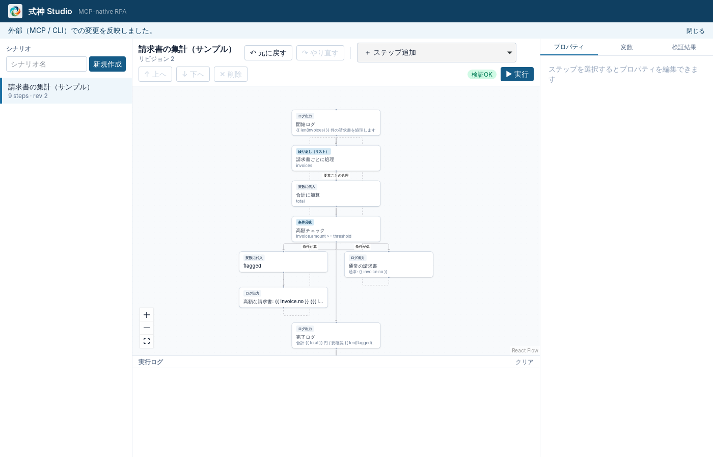

# MCP サーバー

[English](../mcp.md) | 日本語

`spellsheet mcp` は AI クライアント（Claude Code / Codex / Cursor など）に SpellSheet のフロー編集・検証・実行を MCP ツールとして提供します。Writer と同じ Flow Core を使うため、AI の変更は Writer に即座に反映され、Writer から Undo できます。GUI がなくても単独で動きます。



## 接続方法

トランスポートは **stdio** です。AI クライアントが `spellsheet mcp` を子プロセスとして起動します。ネットワークのポートは開きません。`shikigami` コマンドに PATH が通っている必要があります（インストーラーで導入される想定。開発中は `cargo build -p shikigami-cli` の `target/debug/shikigami`）。

### Claude Code

プラグイン（MCP 設定と、フロー作成の作法を教えるスキルを同梱）を入れるのがおすすめです。

```text
/plugin install shikigami --marketplace d-shiina/shikigami
```

（Claude Code 2.1.275 より前は `/plugin marketplace add d-shiina/shikigami` のあと `/plugin install shikigami@shikigami`。）

MCP サーバーだけを登録する場合：

```sh
claude mcp add shikigami -- spellsheet mcp
```

### Codex

`~/.codex/config.toml`：

```toml
[mcp_servers.shikigami]
command = "shikigami"
args = ["mcp"]
```

### Cursor

`.cursor/mcp.json`（プロジェクト）または `~/.cursor/mcp.json`：

```json
{
  "mcpServers": {
    "shikigami": { "command": "shikigami", "args": ["mcp"] }
  }
}
```

### オプション

| オプション | 既定 | 説明 |
|---|---|---|
| `--workspace <DIR>` | `%APPDATA%\SpellSheet\workspace`（`SPELLSHEET_HOME` で変更可） | 対象ワークスペース。Writer と同じ場所を指定すると相互に反映される |
| `--allow read,write,run` | 3 つすべて | 公開するツールの権限区分。例：閲覧だけ許すなら `--allow read` |

## ツール

| 区分 | ツール | 内容 |
|---|---|---|
| read | `list_flows` | フロー一覧 |
|  | `get_flow` | フロー本体（ノード ID 付き）と Undo/Redo の可否。人が差し戻し中なら `feedback`（理由とノードへの指摘）。`flow.call` で呼ぶフローの入力・出力（`subflows`）と、このフローを呼んでいるフロー（`calledBy`） |
|  | `validate_flow` | 保存済み（`flowId`）または未保存の文書（`flow`）を検証。全エラーを JSON Pointer 付きで返す |
|  | `list_step_types` / `get_step_schema` | 使えるノード型と、その params の JSON Schema・コピーして使える記述例（`examples`） |
|  | `get_history` | 誰が（Writer / MCP クライアント名 / CLI）いつ何を変えたか。AI の説明（`summary`）と触ったノード（`stepIds`）付き |
|  | `get_review` | レビュー台と同じ内容：最後の承認以降の変更・AI のテスト実行・根拠にした画面・レビュー（差し戻し理由）。[設計](../design/review-evidence.md) |
|  | `get_run_status` / `get_run_logs` / `list_runs` | 実行中の状態・最終レポート・イベントログ（`afterSeq` で差分取得、`variable` でその変数の変化だけ） |
|  | `list_versions` / `get_version` | 名前付きの版の一覧と、版のスナップショット |
|  | `diff_versions` | 版どうし・版と現在の差分（ノード ID 単位。既定は「最新の版 → 現在」） |
|  | `export_flow` | フローと版、呼び出すサブフローを 1 つのバンドルに（機密変数の初期値は除く）。`path` を渡すと、人や別の PC に渡す `.spx` ファイルを書く。既定は公開中の版（`current` で今の内容）、`include_input` で `input/` のファイルも入れる。既にあるファイルは上書きしない（[設計](../design/sharing-versioning.md)） |
|  | `list_project_files` / `read_project_file` | フローのフォルダー（入力・設定・ひな形・出力・作業・ログ）のファイル一覧と、テキストファイルの中身（[files.md](files.md#フローのフォルダー)） |
|  | `list_secrets` | Writer で登録されたシークレットの名前・サイト・設定済みの項目（値は返さない。[secrets.md](secrets.md)） |
|  | `get_policy` | ワークスペースの `policy.json`：許可するサイト・アプリ、AI の操作の承認（allow / ask / deny）。書き換えるツールはない（[policy.md](policy.md)） |
| write | `create_flow` | 新規作成（ノード ID は省略可） |
|  | `update_flow` | 複数の EditOp を 1 リビジョンとして原子的に適用 |
|  | `add_step` / `update_step` / `remove_step` / `move_step` | 個別の編集 |
|  | （編集系の共通引数） | `summary`：変更の説明。ノードの種類や式を使わない言葉で、1 行目は「フローが何をするようになったか」（確認の見出しになる）。`checks`：人にしか決められないこと（AI の仮定）を 1 問ずつ、10 問まで。Writer が「よい／違う…」で聞く。`observations`：根拠にした画面の `observationId` |
|  | `undo` / `redo` | Writer・CLI と共通の Undo スタック |
|  | `delete_flow` | ゴミ箱へ移動。`expectedRevision` 必須。`destructiveHint` 付き。他のフローから呼ばれていると `FLOW_IN_USE`。既定で人の承認が要る（下の「承認」） |
|  | `create_version` / `restore_version` | 版を保存／版の内容に戻す（Undo できる 1 回の編集） |
|  | `import_flow` | バンドル・フロー文書・`.spx` ファイル（`path`）を取り込む。`check: true` なら取り込まずに、この PC に足りないもの（拡張機能・ログイン情報・許可されていないサイトやアプリ）と同じ ID のフローとの違いだけを返す。同じ ID があれば `IMPORT_CONFLICT`（`onConflict: update / copy` で選ぶ）。バンドルのサブフローもいっしょに取り込む。取り込んだフローは公開されない |
|  | `extract_subflow` | 同じブロックに並んだノードを新しいフローに切り出し、`flow.call` 1 つに置き換える。読み書きする変数は入力・出力として受け渡すので動きは変わらない（[設計](../design/subflows.md)） |
|  | `write_project_file` / `delete_project_file` | フローのフォルダーにファイルを置く（`text`、またはこの PC のファイルを `copyFrom`。置き換えは `overwrite`）/ ごみ箱へ移す |
|  | `save_test_case` | テストケースを保存（`tests/<名前>.json`：`description`・`inputs`・`expect`。置き換えは `overwrite`）。`description` は業務の言葉の約束として書く：Writer の確認パネルは AI が保存したケースを「約束」として結果と一緒に見せる。入力変数でない名前とシークレットの入力は断る（[testing.md](testing.md)） |
|  | `request_secret` | ログイン情報をユーザーに求める。Writer に「ログイン情報が必要です」と出て、名前とサイトが入った登録フォームが開く。値は Writer でだけ入力し、AI には返らない。`waitMs` で登録まで待てる（[secrets.md](secrets.md)） |
| run | `run_flow` | Runtime で作業中の内容を実行（AI の試し実行。AI は実行に関与しない）。`waitMs` で完了まで待てる。`published: true` で公開版を実行。`secret: true` の入力変数には値を渡せない |
|  | `stop_flow` | 実行のキャンセル |
|  | `run_tests` | フローのテストケース（`tests/`、全部か `cases`）を作業中の内容で流し、期待と比べる：`passed`・`failed`・`cases[]`（`mismatches[]`）（[testing.md](testing.md)）。全部終わるまで待つ。承認は `run_flow` と同じ |
| ブラウザ | `inspect_page` | ページのアクセシビリティツリー（`target` の選び方は [browser.md](browser.md)）。証跡としてツリーとスクリーンショットを保存し `observationId` を返す。`image: true` でスクリーンショットも AI に返す |
|  | `ask_user_to_pick` | どの部品かわからないとき、人にブラウザでクリックしてもらい（クリックはページに届かない）、`target` で受け取る。Writer にも依頼が出て、そこから断れる（[browser.md](browser.md)） |
| デスクトップ | `inspect_ui` | 開いているウィンドウの一覧、または 1 つのウィンドウの部品の一覧（`target` の選び方は [desktop.md](desktop.md)）。ウィンドウを見たときは部品ツリーを証跡に保存し `observationId` を返す |
| 試行 | `test_step` | ノードを 1 つその場で実行して出力を返す（browser ノードなら実行後のページ、desktop ノードなら操作したウィンドウも）。フローは変更しない。試した結果を証跡に保存し `observationId` を返す |

- 検証結果の各 issue には直し方のヒント（`hint`：近い名前の候補、必須・使える params、式とテンプレートの書き分けなど）が付きます。AI が 1 回で直せるようにするためです。
- 入力スキーマは Rust の型から自動生成しています。結果は `structuredContent`（JSON）で返します。
- 失敗は MCP のツールエラー（`isError: true`）として `{ code, message, details }` を返すので、AI がエラーコードを見て対処できます。例：`REVISION_CONFLICT`（`details.actual` が現在のリビジョン）、`VALIDATION_FAILED`、`FLOW_NOT_FOUND`。
- 書き込み系は `expectedRevision` を受け付けます。省略時は最新に適用、指定時は他者の変更と競合すると `REVISION_CONFLICT` になり、上書きしません。
- 各ツールには `readOnlyHint` / `destructiveHint` / `openWorldHint` の注釈を付けています（クライアントの承認 UI が利用します）。
- `get_flow` の `published` は公開中の版と、作業中の内容がそれと同じか（`matchesCurrent`）。無人実行は公開版だけを動かし、公開できるのは人だけです（公開のツールはありません）。

## 承認

ワークスペースの `policy.json` が `ask` にしている操作（既定では危険度 `dangerous` のステップを含む `run_flow` と `test_step`、それに `delete_flow`）は、すぐには実行されません。

1. ツールは `APPROVAL_REQUIRED` を返し、`details.approvalId` に依頼の ID が入ります。Writer に承認の依頼が出ます（CLI では `spellsheet approval list`）。
2. AI は人に何をしたいかを伝え、人が Writer で「許可する」と、同じ呼び出しに `approvalId` を付けて呼び直したときに 1 回だけ実行されます。`approvalWaitMs` で答えを待て、`approvalReason` は依頼と一緒に人に見せる理由です。
3. 内容が違うと `APPROVAL_MISMATCH`、使用済みは `APPROVAL_USED`、断られると `APPROVAL_DENIED`、`deny` の操作は `POLICY_DENIED`。許可するサイト・アプリの外は `SITE_NOT_ALLOWED` / `APP_NOT_ALLOWED`。

詳しくは [policy.md](policy.md)。

## 監査ログ

すべてのツール呼び出し（成功・失敗とも）を `<workspace>/audit/mcp.jsonl` に 1 行ずつ記録します。

```json
{"at":"2026-10-28T04:18:04Z","tool":"run_flow","class":"run","client":"claude-code","ok":true,"flowId":"scn_example_invoice_summary","runId":"run_01a1…"}
```

フローの変更内容そのもの（EditOp と逆操作）は、従来どおり `history/<id>/journal.jsonl` にクライアント名付きで記録されます。

## 確認済みの事項と制約

- **確認済み**：rmcp のクライアントを使った自動 E2E（作成 → 追加 → 検証 → 実行 → ログ取得 → 別プロセスからの参照 → Undo/Redo、リビジョン競合、実行の停止、権限による公開ツールの制限、全ツールのスキーマ）。Claude Code CLI 2.1 から `claude mcp add` で登録し、接続（ヘルスチェック）が成功することを確認。Writer を開いたまま MCP で編集すると Writer に反映され、Writer の「元に戻す」が履歴に Writer として記録されることを確認。
- **未確認**：Claude Code に実際にツールを使わせてフローを作らせる対話の確認、Codex / Cursor からの接続、Windows 実機での動作。
- MCP サーバーから開始した実行はサーバープロセス（＝ AI クライアントのセッション）が終わると止まります。長時間・無人の実行は `spellsheet run` を使います。
- ツール権限のクライアント別設定は未実装です（`--allow` によるサーバー単位の制限と、ワークスペース全体の `policy.json`）。
- 監査ログは JSONL です。SQLite への索引化は未実装です。
- Streamable HTTP トランスポートは未実装です（stdio のみ）。
- 画面を調べるツールは、ブラウザ用が `inspect_page`（[browser.md](browser.md)）、Windows のアプリ用が `inspect_ui`（[desktop.md](desktop.md)）です。どちらも `test_step` で 1 ノードずつ試せます。
