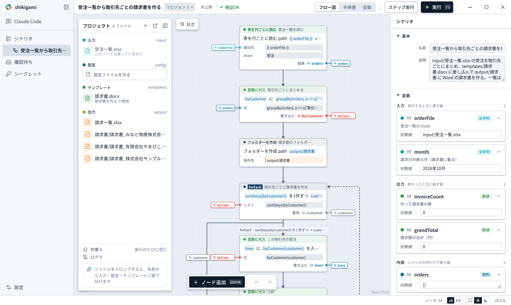

# 受注一覧から取引先ごとの請求書を作る

[English](../../tutorials/invoices.md) | 日本語

Excel の受注一覧を取引先ごとにまとめ、Word のひな形に差し込んで請求書を作ります。Word も Excel も入っていない PC で動きます（ファイルを直接読み書きします）。

- できるもの：`output/請求書/請求書_<取引先>.docx`（取引先の数だけ）と `output/請求一覧.xlsx`
- 見本：`examples/tutorials/invoices/`（完成形は `examples/tutorials/invoices.spellsheet.json`）
- かかる時間：約 15 分



## 1. フローを作り、ファイルを置く

1. フローの画面で「新規作成」
2. プロジェクトの棚に次の 2 つをドロップします
   - `input/受注一覧.xlsx`：シート「受注」に 注文番号・受注日・取引先・商品・金額
   - `templates/請求書_ひな形.docx`：請求書のひな形（名前に「ひな形」が入っているので「テンプレート」に振り分けられます）

ひな形には `{{ 顧客 }}`・`{{ 発行日 }}`・`{{ 当月 }}`・`{{ 合計 }}` と、明細の表の行に `{{ 明細.注文番号 }}`・`{{ 明細.商品 }}`・`{{ 明細.金額 }}` が書いてあります。表の行は明細の数だけ増えます（[Office の操作](../office.md)）。自社のひな形を使うときも、差し込みたい所にこの形で名前を書くだけです。

## 2. AI に依頼する

```
input/受注一覧.xlsx（シート「受注」）の受注を取引先ごとにまとめて、
templates/請求書_ひな形.docx に差し込み、取引先ごとの請求書を output/請求書 に作ってください。
・差し込む名前：顧客、発行日（今日、2026年11月6日 の形）、当月、合計（カンマ付き）、明細（注文番号・商品・金額）
・対象の月（「2026年10月」の形）は入力変数にする
・作った請求書の一覧（取引先・件数・請求額・ファイル名）を output/請求一覧.xlsx に書く
```

AI はまずひな形の差し込み名を読んでから組みます。見本の完成形は次のとおりです。

| ノード | していること |
|---|---|
| 受注一覧を読む（`excel.readRows`） | 見出しを項目名にして 1 行ずつ読む |
| 取引先ごとにまとめる（`variable.set`） | `groupBy(orders, o => o['取引先'])` |
| 取引先ごとに請求書を作る（`control.forEach`） | 小計を出し、`word.fillTemplate` で差し込む |
| 請求一覧を書く（`excel.appendRows`） | 1 取引先 1 行 |

## 3. 確かめて確定する

「確認待ち」で、外への影響に `output/請求書/` と `output/請求一覧.xlsx` が並ぶことを確かめます。AI の試し実行で作られた請求書は、棚の「出力」から開いて中身を確かめられます。よければ「確認して確定」。

## 4. 試す

「実行」（F5）を押します。

```
2026年10月分の請求書を 3 通、合計 219,600 円で作りました
```

**よくある止まり方**

- ひな形の差し込み名と渡す名前が合わないと「ひな形に入れる値が足りません」と出ます。ひな形の `{{ }}` の名前を直すか、「Claude Codeに直してもらう」を押します
- 受注一覧のシート名が違うと「シート『受注』がありません」と、実際にあるシートの名前と一緒に出ます

## 5. 毎月動かす

月が変わったら、受注一覧を差し替えて、入力 `month` を変えて実行します。

```bash
spellsheet run scn_tutorial_invoices -i month=2026年11月
```

## 次は

- [Web の受注システムで未処理の注文を出荷する](web-orders.md)：ブラウザを操作する
