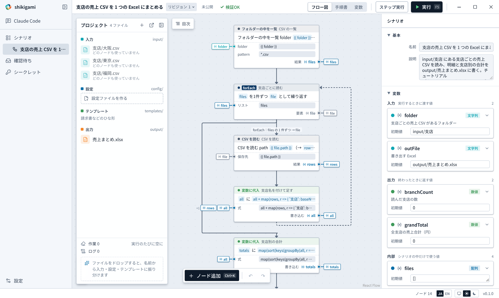

# 支店の売上 CSV を 1 つの Excel にまとめる

[English](../../tutorials/sales-csv.md) | 日本語

毎月、支店ごとに届く売上の CSV を 1 つの Excel にまとめ、支店別の合計を付けます。

- できるもの：`output/売上まとめ.xlsx`（シート「明細」と「支店別」）
- 見本：`examples/tutorials/sales-csv/`（完成形は `examples/tutorials/sales-csv.spellsheet.json`）
- かかる時間：約 10 分



## 1. フローを作り、CSV を置く

1. フローの画面で「新規作成」。名前は「支店の売上をまとめる」など
2. `examples/tutorials/sales-csv/input/` の 3 つの CSV（東京・大阪・福岡）をプロジェクトの棚にドロップします。CSV はフローのフォルダーの `input/` に入ります

CSV は 1 行目が見出しで、`日付,商品,数量,金額` の 4 列です。金額には `"6,000"` のようにカンマ付きの値も混じっています。

## 2. AI に依頼する

AI のペインに次の文を貼ります。

```
input にある CSV（支店ごとの売上、1 行目が見出し：日付・商品・数量・金額）を全部読んで、
1 つの Excel（output/売上まとめ.xlsx）にまとめてください。
・シート「明細」：全部の行に「支店」の列（ファイル名から）を足したもの。数量と金額は数にする
・シート「支店別」：支店・件数・金額の合計
・フォルダーと出力ファイルは入力変数にして、毎月変えられるようにする
・同じ月を何度実行しても行が重ならないように、前の出力は消してから書く
```

AI は CSV を読み、ノードを足しながら試し実行を繰り返します。見本の完成形では次のノードになります。

| ノード | していること |
|---|---|
| CSV の一覧（`file.list`） | `input` の `*.csv` を並べる |
| 支店ごとに読む（`control.forEach`） | 1 ファイルずつ `file.readCsv` で読み、`baseName(file.name)` を「支店」にして足す |
| 支店別の合計（`variable.set`） | `groupBy` と `sum` で支店ごとの件数と金額を出す |
| 前回の Excel を消す → シートを足す → 行を書く | `file.delete`、`excel.addSheet`、`excel.appendRows` |

金額の `"6,000"` は式の `num()` が数にします（[式と関数](../expressions.md)）。

## 3. 変更を承諾する

サイドバーの「確認待ち」を開くと、AI が変えた内容が手順書と同じ文で並び、外への影響（読み書きするファイル）と AI の試し実行の結果が出ます。`output/売上まとめ.xlsx` に書くことを確かめたら「変更を承諾」を押します。

## 4. 試す

タイトルバーの「実行」（F5）を押します。実行ログに次の行が出れば成功です。

```
3 支店・8 行、合計 73,050 円を output/売上まとめ.xlsx に書きました
```

プロジェクトの棚の「出力」に `売上まとめ.xlsx` が出ます。押すと Excel で開けます。

**よくある止まり方**：`売上まとめ.xlsx` を Excel で開いたまま実行すると、「『output/売上まとめ.xlsx』がほかのアプリで開かれています」と出て止まります。Excel で閉じてから「もう一度」を押せば続きます。

## 5. 毎月動かす

来月は CSV を入れ替えて実行するだけです。フォルダーを変えたいときは、実行するときに入力 `folder` を変えます。

```bash
spellsheet run scn_tutorial_sales_csv -i folder=C:\共有\売上\2026-11
```

## 6. テストを残す

直したあとも同じ結果になるか確かめられるよう、`tests/` にテストケースを置いておきます（見本は `examples/tutorials/sales-csv/tests/`）。

```bash
spellsheet test scn_tutorial_sales_csv --draft
```

書き方は [フローのテスト](../testing.md) を参照してください。

## 次は

- [受注一覧から取引先ごとの請求書を作る](invoices.md)：まとめた結果を Word の請求書にする
