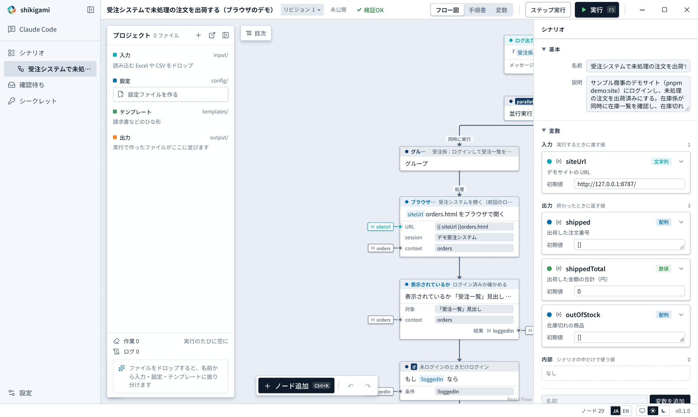

# Web の受注システムで未処理の注文を出荷する

[English](../../tutorials/web-orders.md) | 日本語

社内の Web システムにログインし、一覧から未処理の注文を 1 件ずつ出荷済みにします。練習用の受注システム（デモサイト）が付いているので、本物のシステムに触らずに試せます。

- できるもの：デモサイトの未処理の注文がすべて出荷済みになり、出荷した注文番号と合計が出力に残る
- 見本：`examples/browser-demo.json`、デモサイトは `examples/web/`
- かかる時間：約 15 分



## 1. デモサイトを起動する

```bash
pnpm demo:site
```

`http://127.0.0.1:8787/` に「サンプル商事 受注システム」が開きます。ユーザー名 `demo`、パスワード `shikigami` でログインできます。

## 2. ログイン情報をシークレットに登録する

パスワードはシナリオにも AI にも渡しません。サイドバーの「シークレット」で「新しく登録」し、次のように登録します。

| 項目 | 値 |
|---|---|
| 名前 | デモ受注システム |
| ユーザー名 / パスワード | demo / shikigami |
| 入力してよいサイト・アプリ | http://127.0.0.1:8787 |

シナリオと AI が知るのは名前「デモ受注システム」だけです。値は登録したサイトの入力欄にだけ打ち込まれます（[シークレット](../secrets.md)）。

## 3. AI に頼む

```
受注システム（http://127.0.0.1:8787/orders.html）にシークレット「デモ受注システム」でログインし、
受注一覧で状態が「未処理」の注文を 1 件ずつ「出荷」ボタンで出荷済みにしてください。
・前回のログイン状態が残っていればログイン画面は飛ばす
・出荷した注文番号の一覧と金額の合計を出力にする
・最後に「未処理」が残っていないことを確かめる
```

AI はページを開いて部品を調べ（`inspect_page`）、ボタンや見出しの名前でノードを組みます。座標や画像ではなく「『ログイン』ボタン」のように指すので、画面の配置が少し変わっても動きます。

## 4. 確かめて公開する

「確認待ち」の外への影響に、開くサイト `http://127.0.0.1:8787` とシークレット「デモ受注システム」の使い道が並びます。行き先が正しいことを確かめて「確認して公開」。

## 5. 試す

「実行」（F5）を押すとブラウザが開き、ログインから出荷までが画面で見えます。フロー図は実行中のノードを追います。

**よくある止まり方**

- 「『ログイン』ボタンが見つかりません」：画面の文言が変わったか、ページが出る前に押そうとしています。止まった時点の画面と変数がパネルに出るので、見比べて直すか「Claude Codeに直してもらう」を押します。直したら「直した内容で再開」でその場から続きます
- 「今のページはシークレット『デモ受注システム』を使ってよいサイトではありません」：シークレットのサイトのアドレスがずれています。ポート番号まで同じか確かめてください

## 6. 本物のシステムで使うときは

- 社内のシステムのアドレスを、設定の「許可と承認」で許可したサイトに入れておくと、ほかのサイトには行かなくなります（[許可と承認](../policy.md)）
- 二段階認証や画像認証があるときは、人が操作するのを待つノード（`browser.waitForHuman`）を入れます
