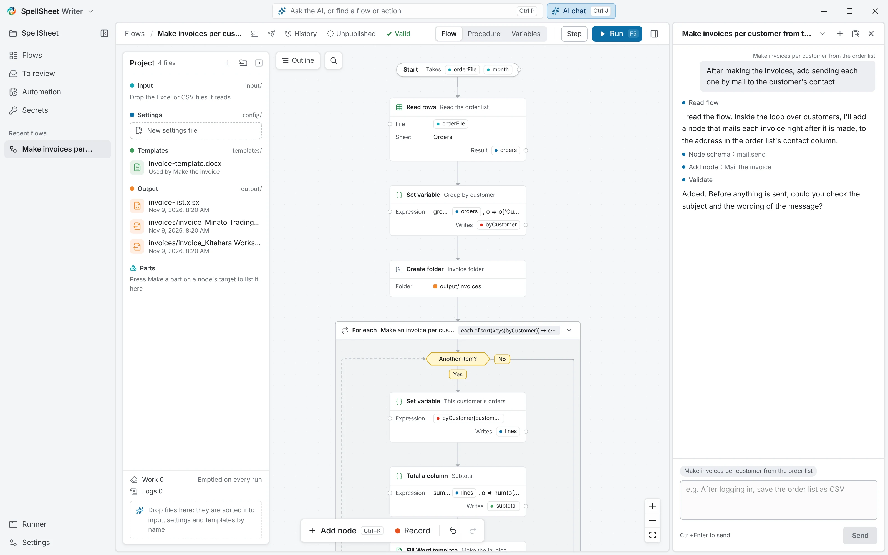

# MCP server

English | [日本語](ja/mcp.md)

`spellsheet mcp` gives AI clients (Claude Code, Codex, Cursor and others) SpellSheet's flow editing, validation and execution as MCP tools. It uses the same Flow Core as Writer, so AI edits show up in Writer immediately and can be undone there. It also runs on its own, without a GUI.

<picture>
  <source srcset="assets/writer-en-dark.webp" media="(prefers-color-scheme: dark)">
  
</picture>

## Connecting

The transport is **stdio**: the AI client starts `spellsheet mcp` as a child process. No network port is opened. The `spellsheet` command must be on PATH (the installer puts it there; during development it is `target/debug/spellsheet` from `cargo build -p spellsheet-cli`).

### Claude Code

The plugin is recommended: it bundles the MCP settings and a skill that teaches how to write flows.

```text
/plugin install spellsheet --marketplace spellsheet/spellsheet
```

(Before Claude Code 2.1.275: `/plugin marketplace add spellsheet/spellsheet`, then `/plugin install spellsheet@spellsheet`.)

To register only the MCP server:

```sh
claude mcp add spellsheet -- spellsheet mcp
```

### Codex

`~/.codex/config.toml`:

```toml
[mcp_servers.spellsheet]
command = "spellsheet"
args = ["mcp"]
```

### Cursor

In Writer, **Settings → AI → MCP server registration → Cursor → Add to Cursor** opens Cursor's own "add MCP server" prompt with the installed CLI filled in, so nothing is edited by hand. The same place shows the commands for Claude Code, Codex, Gemini CLI and GitHub Copilot. To write the file yourself instead:

`.cursor/mcp.json` (project) or `~/.cursor/mcp.json`:

```json
{
  "mcpServers": {
    "spellsheet": { "command": "spellsheet", "args": ["mcp"] }
  }
}
```

### Options

| Option | Default | Description |
|---|---|---|
| `--workspace <DIR>` | `%APPDATA%\SpellSheet\workspace` (change with `SPELLSHEET_HOME`) | The workspace. Point it at the same place as Writer and changes show up in both |
| `--allow read,write,run` | All three | Which tool classes to expose. For read-only access: `--allow read` |

## Tools

| Class | Tool | What it does |
|---|---|---|
| read | `list_flows` | List flows |
|  | `get_flow` | The flow (with node IDs) and whether Undo/Redo is possible. While a person has sent it back, `feedback` (the reason and notes on nodes). Inputs and outputs of flows called with `flow.call` (`subflows`), and the flows that call this one (`calledBy`) |
|  | `validate_flow` | Validates a saved flow (`flowId`) or an unsaved document (`flow`). Returns every error with a JSON Pointer |
|  | `list_step_types` / `get_step_schema` | Available node types, the JSON Schema of their params, and examples to copy (`examples`) |
|  | `get_history` | Who (Writer / MCP client name / CLI) changed what and when, with the AI's explanation (`summary`) and the nodes touched (`stepIds`) |
|  | `get_review` | What the review desk shows: changes since the last approval, the AI's test runs, the screens it relied on, and reviews (reasons for sending back). [Design](design/review-evidence.md) |
|  | `get_run_status` / `get_run_logs` / `list_runs` | Status of a run, its final report, and its event log (`afterSeq` for what is new, `variable` for one variable's changes only) |
|  | `list_versions` / `get_version` | Named versions, and a version's snapshot |
|  | `diff_versions` | Differences between versions, or a version and now (by node ID; by default "latest version → now") |
|  | `export_flow` | The flow, its versions and the subflows it calls, as one bundle (without defaults of secret variables). With `path`, writes a `.spx` file to hand to another person or PC instead: the published version by default (`current` for the content now), `include_input` for files in `input/`; it never overwrites a file ([design](design/sharing-versioning.md)) |
|  | `list_project_files` / `read_project_file` | The files in the flow's folder (input, config, templates, output, work, logs), and a text file's contents ([files.md](files.md#the-flows-folder)) |
|  | `list_secrets` | Names, sites and set fields of the secrets registered in Writer (never the values; see [secrets.md](secrets.md)) |
|  | `get_policy` | The workspace's `policy.json`: the allowed sites and apps, and what the AI may do (allow / ask / deny). No tool changes it ([policy.md](policy.md)) |
| write | `create_flow` | Create a flow (node IDs optional) |
|  | `update_flow` | Apply several EditOps atomically as one revision |
|  | `add_step` / `update_step` / `remove_step` / `move_step` | Single edits |
|  | (common edit arguments) | `summary`: what the change does, in plain words (first line: what the flow now does differently; shown as the review's heading). `checks`: questions only a person can answer (assumptions), one each, up to 10; Writer shows them with OK / No. `observations`: the `observationId`s of the screens it is based on |
|  | `undo` / `redo` | The Undo stack shared with Writer and the CLI |
|  | `delete_flow` | Move to the trash. `expectedRevision` required, marked `destructiveHint`. `FLOW_IN_USE` while another flow calls it. Needs a person's approval by default (see "Approval" below) |
|  | `create_version` / `restore_version` | Save a version / go back to a version (one edit that can be undone) |
|  | `import_flow` | Import a bundle, a flow document, or a `.spx` file (`path`). `check: true` only reports what this PC is missing (extensions, secrets, sites and apps not allowed) and how it differs from a flow with the same ID. `IMPORT_CONFLICT` when the ID exists (choose with `onConflict: update / copy`). Subflows in the bundle come along. An imported flow is not published |
|  | `extract_subflow` | Move consecutive nodes of one block into a new flow and replace them with a single `flow.call`. Variables they read and write become inputs and outputs, so nothing changes in how it runs ([design](design/subflows.md)) |
|  | `write_project_file` / `delete_project_file` | Put a file in the flow's folder (`text`, or `copyFrom` a file on this PC; `overwrite` to replace) / move one to the trash |
|  | `save_test_case` | Save a test case (`tests/<name>.json`: `description`, `inputs` and `expect`; `overwrite` to replace). Write `description` as a promise in business words: Writer's review shows the cases an AI saved as its promises, with their results. Unknown or secret inputs are refused ([testing.md](testing.md)) |
|  | `request_secret` | Ask the person for login details. Writer shows "Login needed" and opens the registration form with the name and sites filled in. Values are entered only in Writer and never returned to the AI. `waitMs` waits for the registration ([secrets.md](secrets.md)) |
| run | `run_flow` | Run the work in progress with the Runtime (the AI's trial run; the AI takes no part in running it). `waitMs` waits for it to finish. `published: true` runs the published version. Input variables marked `secret: true` cannot be passed |
|  | `stop_flow` | Cancel a run |
|  | `run_tests` | Run the flow's test cases (`tests/`, all or `cases`) with the work in progress and compare each with what it expects: `passed`, `failed`, `cases[]` with `mismatches[]` ([testing.md](testing.md)). Waits until all have run; approval as for `run_flow` |
| browser | `inspect_page` | The page's accessibility tree (how to choose a `target`: [browser.md](browser.md)). Saves the tree and a screenshot as evidence and returns an `observationId`. `image: true` also returns the screenshot to the AI |
|  | `ask_user_to_pick` | When the AI cannot tell which element is meant, the person clicks it in the browser (the click does not reach the page) and it comes back as a `target`. Writer shows the request and can decline it ([browser.md](browser.md)) |
| desktop | `inspect_ui` | The open windows, or the elements of one window (how to choose a `target`: [desktop.md](desktop.md)). When it looks at a window it saves the element tree as evidence and returns an `observationId` |
| try | `test_step` | Run one node on the spot and return its output (for a browser node also the page after it, for a desktop node the window it worked on). A node that reads variables (`{{ row.顧客名 }}`, an expression) is tried as written: pass their values in `variables`, as they would be at that point of a run. Does not change the flow. Saves the result as evidence and returns an `observationId` |

- Each validation issue carries a hint for fixing it (`hint`: close names, required and allowed params, when to use expressions vs. templates…), so the AI can fix it in one go.
- Input schemas are generated from the Rust types. Results come back as `structuredContent` (JSON).
- Failures are MCP tool errors (`isError: true`) with `{ code, message, details }`, so the AI can act on the code. For example: `REVISION_CONFLICT` (`details.actual` is the current revision), `VALIDATION_FAILED`, `FLOW_NOT_FOUND`.
- Write tools accept `expectedRevision`. Without it the edit applies to the latest revision; with it, a conflicting change by someone else gives `REVISION_CONFLICT` instead of overwriting.
- Every tool is annotated with `readOnlyHint` / `destructiveHint` / `openWorldHint` (clients use them in their approval UI).
- `published` in `get_flow` is the published version and whether the work in progress matches it (`matchesCurrent`). Unattended runs execute only the published version, and only a person can publish (there is no tool for it).

## Approval

Operations that the workspace's `policy.json` sets to `ask` (by default `run_flow` and `test_step` with a node of risk `dangerous`, and `delete_flow`) do not run straight away.

1. The tool returns `APPROVAL_REQUIRED` with the request's ID in `details.approvalId`. Writer shows the request (on the CLI, `spellsheet approval list`).
2. The AI tells the person what it wants to do. Once the person clicks "Approve" in Writer, calling the same tool again with `approvalId` runs it, once. `approvalWaitMs` waits for the answer; `approvalReason` is shown to the person with the request.
3. Different content gives `APPROVAL_MISMATCH`, a used approval `APPROVAL_USED`, a refusal `APPROVAL_DENIED`, and a `deny` operation `POLICY_DENIED`. Sites and apps outside the allowed ones give `SITE_NOT_ALLOWED` / `APP_NOT_ALLOWED`.

See [policy.md](policy.md).

## Audit log

Every tool call (successful or not) is written as one line to `<workspace>/audit/mcp.jsonl`.

```json
{"at":"2026-10-28T04:18:04Z","tool":"run_flow","class":"run","client":"claude-code","ok":true,"flowId":"scn_example_invoice_summary","runId":"run_01a1…"}
```

The flow changes themselves (EditOps and their inverses) are recorded with the client name in `history/<id>/journal.jsonl`, as before.

## Verified and limits

- **Verified**: automated E2E with the rmcp client (create → add → validate → run → read logs → read from another process → Undo/Redo, revision conflicts, stopping a run, tools limited by `--allow`, the schemas of every tool). Registered with `claude mcp add` from Claude Code CLI 2.1 and the connection (health check) succeeds. Editing over MCP with Writer open shows up in Writer, and Writer's Undo is recorded in the history as Writer.
- **Not yet verified**: a conversation where Claude Code actually builds a flow with the tools, connecting from Codex / Cursor, and running on real Windows machines.
- Runs started from the MCP server stop when the server process (= the AI client's session) ends. Use `spellsheet run` for long or unattended runs.
- Per-client tool permissions are not implemented (there is the server-wide `--allow` and the workspace-wide `policy.json`).
- The audit log is JSONL. Indexing it in SQLite is not implemented.
- The Streamable HTTP transport is not implemented (stdio only).
- Screens are inspected with `inspect_page` for browsers ([browser.md](browser.md)) and `inspect_ui` for Windows apps ([desktop.md](desktop.md)). Both can be tried step by node with `test_step`.
