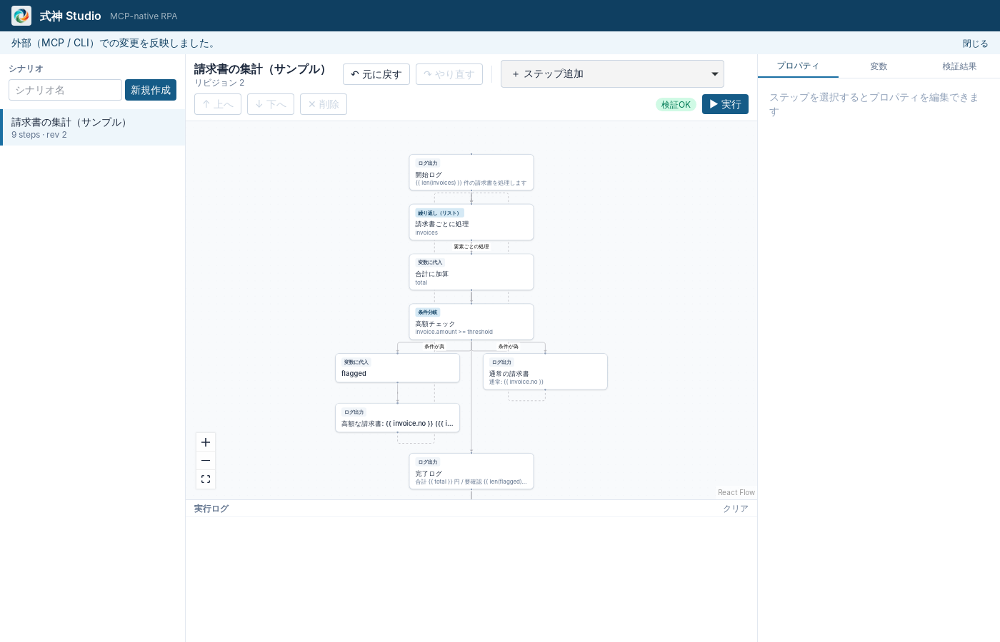

# MCP サーバー

`shikigami mcp` は AI クライアント（Claude Code / Codex / Cursor など）に Shikigami のシナリオ編集・検証・実行を MCP ツールとして提供します。Studio と同じ Scenario Core を使うため、AI の変更は Studio に即座に反映され、Studio から Undo できます。GUI がなくても単独で動きます。



## 接続方法

トランスポートは **stdio** です。AI クライアントが `shikigami mcp` を子プロセスとして起動します。ネットワークのポートは開きません。`shikigami` コマンドに PATH が通っている必要があります（インストーラーで導入される想定。開発中は `cargo build -p shikigami-cli` の `target/debug/shikigami`）。

### Claude Code

プラグイン（MCP 設定と、シナリオ作成の作法を教えるスキルを同梱）を入れるのがおすすめです。

```text
/plugin install shikigami --marketplace d-shiina/shikigami
```

（Claude Code 2.1.275 より前は `/plugin marketplace add d-shiina/shikigami` のあと `/plugin install shikigami@shikigami`。リポジトリが Private の間は、GitHub でアクセス権のあるアカウントが必要です。）

MCP サーバーだけを登録する場合：

```sh
claude mcp add shikigami -- shikigami mcp
```

### Codex

`~/.codex/config.toml`：

```toml
[mcp_servers.shikigami]
command = "shikigami"
args = ["mcp"]
```

### Cursor

`.cursor/mcp.json`（プロジェクト）または `~/.cursor/mcp.json`：

```json
{
  "mcpServers": {
    "shikigami": { "command": "shikigami", "args": ["mcp"] }
  }
}
```

### オプション

| オプション | 既定 | 説明 |
|---|---|---|
| `--workspace <DIR>` | `%APPDATA%\Shikigami\workspace`（`SHIKIGAMI_HOME` で変更可） | 対象ワークスペース。Studio と同じ場所を指定すると相互に反映される |
| `--allow read,write,run` | 3 つすべて | 公開するツールの権限区分。例：閲覧だけ許すなら `--allow read` |

## ツール

| 区分 | ツール | 内容 |
|---|---|---|
| read | `list_scenarios` | シナリオ一覧 |
|  | `get_scenario` | シナリオ本体（ステップ ID 付き）と Undo/Redo の可否 |
|  | `validate_scenario` | 保存済み（`scenarioId`）または未保存の文書（`scenario`）を検証。全エラーを JSON Pointer 付きで返す |
|  | `list_step_types` / `get_step_schema` | 使えるステップ型と、その params の JSON Schema・コピーして使える記述例（`examples`） |
|  | `get_history` | 誰が（Studio / MCP クライアント名 / CLI）いつ何を変えたか |
|  | `get_run_status` / `get_run_logs` / `list_runs` | 実行中の状態・最終レポート・イベントログ（`afterSeq` で差分取得） |
|  | `list_secrets` | Studio で登録されたシークレットの名前・サイト・設定済みの項目（値は返さない。[secrets.md](secrets.md)） |
| write | `create_scenario` | 新規作成（ステップ ID は省略可） |
|  | `update_scenario` | 複数の EditOp を 1 リビジョンとして原子的に適用 |
|  | `add_step` / `update_step` / `remove_step` / `move_step` | 個別の編集 |
|  | `undo` / `redo` | Studio・CLI と共通の Undo スタック |
|  | `delete_scenario` | ゴミ箱へ移動。`expectedRevision` 必須。`destructiveHint` 付き |
| run | `run_scenario` | Runtime で実行（AI は実行に関与しない）。`waitMs` で完了まで待てる。`secret: true` の入力変数には値を渡せない |
|  | `stop_scenario` | 実行のキャンセル |
| ブラウザ | `inspect_page` | ページのアクセシビリティツリー（`target` の選び方は [browser.md](browser.md)） |
| デスクトップ | `inspect_ui` | 開いているウィンドウの一覧、または 1 つのウィンドウの部品の一覧（`target` の選び方は [desktop.md](desktop.md)） |
| 試行 | `test_step` | ステップを 1 つその場で実行して出力を返す（browser ステップなら実行後のページ、desktop ステップなら操作したウィンドウも）。シナリオは変更しない |

- 検証結果の各 issue には直し方のヒント（`hint`：近い名前の候補、必須・使える params、式とテンプレートの書き分けなど）が付きます。AI が 1 回で直せるようにするためです。
- 入力スキーマは Rust の型から自動生成しています。結果は `structuredContent`（JSON）で返します。
- 失敗は MCP のツールエラー（`isError: true`）として `{ code, message, details }` を返すので、AI がエラーコードを見て対処できます。例：`REVISION_CONFLICT`（`details.actual` が現在のリビジョン）、`VALIDATION_FAILED`、`SCENARIO_NOT_FOUND`。
- 書き込み系は `expectedRevision` を受け付けます。省略時は最新に適用、指定時は他者の変更と競合すると `REVISION_CONFLICT` になり、上書きしません。
- 各ツールには `readOnlyHint` / `destructiveHint` / `openWorldHint` の注釈を付けています（クライアントの承認 UI が利用します）。

## 監査ログ

すべてのツール呼び出し（成功・失敗とも）を `<workspace>/audit/mcp.jsonl` に 1 行ずつ記録します。

```json
{"at":"2026-10-28T04:18:04Z","tool":"run_scenario","class":"run","client":"claude-code","ok":true,"scenarioId":"scn_example_invoice_summary","runId":"run_01a1…"}
```

シナリオの変更内容そのもの（EditOp と逆操作）は、従来どおり `history/<id>/journal.jsonl` にクライアント名付きで記録されます。

## 確認済みの事項と制約

- **確認済み**：rmcp のクライアントを使った自動 E2E（作成 → 追加 → 検証 → 実行 → ログ取得 → 別プロセスからの参照 → Undo/Redo、リビジョン競合、実行の停止、権限による公開ツールの制限、全ツールのスキーマ）。Claude Code CLI 2.1 から `claude mcp add` で登録し、接続（ヘルスチェック）が成功することを確認。Studio を開いたまま MCP で編集すると Studio に反映され、Studio の「元に戻す」が履歴に Studio として記録されることを確認。
- **未確認**：Claude Code に実際にツールを使わせてシナリオを作らせる対話の確認、Codex / Cursor からの接続、Windows 実機での動作。
- MCP サーバーから開始した実行はサーバープロセス（＝ AI クライアントのセッション）が終わると止まります。長時間・無人の実行は `shikigami run` を使います。
- 削除の「Studio 上での人間の承認」、ツール権限のクライアント別設定、シナリオ単位の「MCP からの実行可否」は未実装です（現状は `--allow` によるサーバー単位の制限のみ）。
- 監査ログは JSONL です。SQLite への索引化は未実装です。
- Streamable HTTP トランスポートは未実装です（stdio のみ）。
- 画面を調べるツールは、ブラウザ用が `inspect_page`（[browser.md](browser.md)）、Windows のアプリ用が `inspect_ui`（[desktop.md](desktop.md)）です。どちらも `test_step` で 1 ステップずつ試せます。
