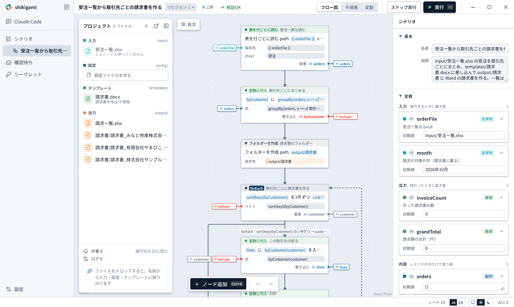

# Make an invoice per customer from an order list

English | [日本語](../ja/tutorials/invoices.md)

Group an Excel order list by customer and fill a Word template to make the invoices. It runs on a PC without Word or Excel (the files are read and written directly).

- Result: `output/請求書/請求書_<customer>.docx` (one per customer) and `output/請求一覧.xlsx`
- Sample: `examples/tutorials/invoices/` (finished: `examples/tutorials/invoices.shikigami.json`)
- Time: about 15 minutes



## 1. Make a flow and add the files

1. "New flow" on the Flows page
2. Drop these two on the project shelf
   - `input/受注一覧.xlsx`: sheet 受注 with 注文番号 (order no.), 受注日 (date), 取引先 (customer), 商品 (item), 金額 (amount)
   - `templates/請求書_ひな形.docx`: the invoice template (ひな形, "template", in the name sorts it onto the "Templates" shelf)

The template has `{{ 顧客 }}`, `{{ 発行日 }}`, `{{ 当月 }}`, `{{ 合計 }}`, and in a table row `{{ 明細.注文番号 }}`, `{{ 明細.商品 }}`, `{{ 明細.金額 }}`. The row repeats once per line item ([Office](../office.md)). To use your own template, write the names in this form where the values go.

## 2. Ask the AI

```
Group the orders in input/受注一覧.xlsx (sheet 受注) by customer (取引先), fill templates/請求書_ひな形.docx,
and make one invoice per customer in output/請求書.
- Names to fill: 顧客 (customer), 発行日 (today, like 2026年11月6日), 当月 (the month), 合計 (total, with commas), 明細 (order no., item, amount)
- Make the month (like 2026年10月) an input variable
- Write a list of the invoices (customer, count, amount, file name) to output/請求一覧.xlsx
```

The AI reads the template's names first. The finished sample:

| Node | What it does |
|---|---|
| Read the orders (`excel.readRows`) | One record per row, keyed by the header |
| Group by customer (`variable.set`) | `groupBy(orders, o => o['取引先'])` |
| Make each invoice (`control.forEach`) | A subtotal, then `word.fillTemplate` |
| Write the list (`excel.appendRows`) | One row per customer |

## 3. Check and publish

Under "To review", check that `output/請求書/` and `output/請求一覧.xlsx` are listed as what it touches. The invoices from the AI's test runs are on the "Output" shelf to open and read. Then "Accept changes".

## 4. Try it

Press "Run" (F5):

```
2026年10月分の請求書を 3 通、合計 219,600 円で作りました
```

**Common stops**

- When the template's names and the values do not match: "A value for the template is missing". Fix the `{{ }}` names in the template, or press "Fix with Claude Code"
- When the sheet name is wrong: "There is no sheet 受注", with the sheets the workbook has

## 5. Run it every month

Replace the order list, and run with the new month:

```bash
spellsheet run scn_tutorial_invoices -i month=2026年11月
```

## Next

- [Ship pending orders in a web order system](web-orders.md): drive a browser
