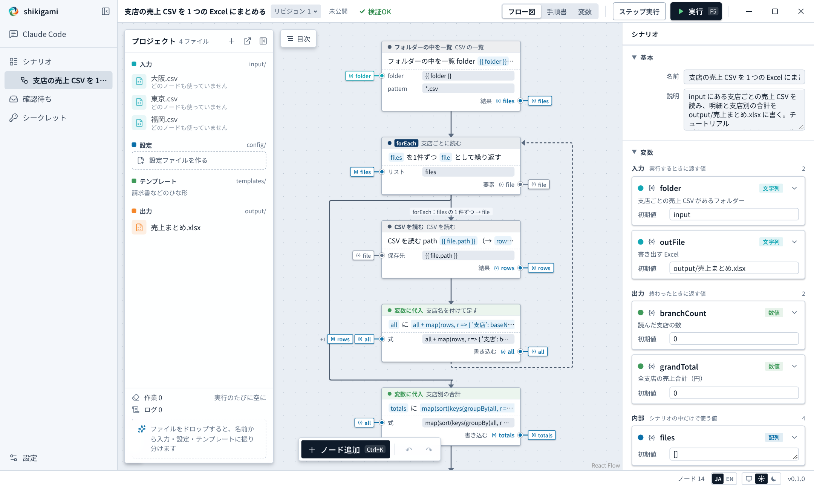

# Combine branch sales CSVs into one Excel workbook

English | [日本語](../ja/tutorials/sales-csv.md)

Every month each branch sends its sales as a CSV. Combine them into one workbook with a total per branch.

- Result: `output/売上まとめ.xlsx` (sheets 明細 "details" and 支店別 "per branch")
- Sample: `examples/tutorials/sales-csv/` (finished: `examples/tutorials/sales-csv.shikigami.json`)
- Time: about 10 minutes



## 1. Make a scenario and add the CSVs

1. "New scenario" on the Scenarios page
2. Drop the three CSVs in `examples/tutorials/sales-csv/input/` (東京 Tokyo, 大阪 Osaka, 福岡 Fukuoka) on the project shelf. CSV files go to `input/` in the scenario's folder

Each CSV has a header row and four columns: 日付 (date), 商品 (item), 数量 (quantity), 金額 (amount). Some amounts carry commas, such as `"6,000"`.

## 2. Ask the AI

Paste this into the AI pane (in Japanese or English; the AI works either way):

```
Read every CSV in input (sales per branch; header row: 日付, 商品, 数量, 金額)
and combine them into one workbook, output/売上まとめ.xlsx.
- Sheet 明細: every row, with a 支店 (branch) column taken from the file name. Quantities and amounts as numbers
- Sheet 支店別: branch, number of rows, total amount
- Make the folder and the output file input variables, so they can change each month
- Delete the previous output first, so running the same month twice never duplicates rows
```

The finished sample has these nodes:

| Node | What it does |
|---|---|
| List the CSVs (`file.list`) | `*.csv` in `input` |
| Read each branch (`control.forEach`) | Reads each file with `file.readCsv` and adds `baseName(file.name)` as the branch |
| Totals per branch (`variable.set`) | Counts and sums per branch with `groupBy` and `sum` |
| Delete the old workbook → add sheets → write rows | `file.delete`, `excel.addSheet`, `excel.appendRows` |

The expression function `num()` turns `"6,000"` into a number ([expressions](../expressions.md)).

## 3. Check and publish

Open "To review" in the sidebar. The AI's changes are listed in the same sentences as the procedure view, with what it touches outside (the files it reads and writes) and the results of its test runs. Once you have checked that it writes `output/売上まとめ.xlsx`, press "Review and publish".

## 4. Try it

Press "Run" (F5). The run log ends with:

```
3 支店・8 行、合計 73,050 円を output/売上まとめ.xlsx に書きました
```

`売上まとめ.xlsx` appears on the "Output" shelf; press it to open it in Excel.

**A common stop**: with `売上まとめ.xlsx` open in Excel, the run stops with "output/売上まとめ.xlsx is open in another app". Close it in Excel and press "Retry".

## 5. Run it every month

Next month, replace the CSVs and run it. To use another folder, change the `folder` input:

```bash
shikigami run scn_tutorial_sales_csv -i folder=C:\share\sales\2026-11
```

## Next

- [Make an invoice per customer from an order list](invoices.md): turn totals into Word invoices
