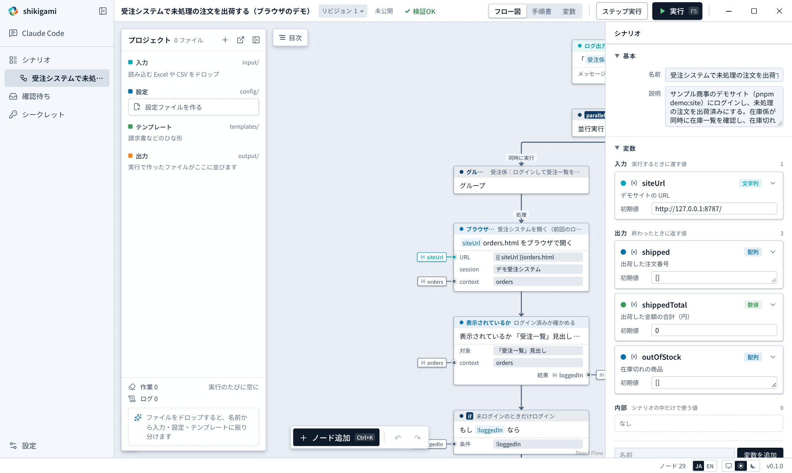

# Ship pending orders in a web order system

English | [日本語](../ja/tutorials/web-orders.md)

Sign in to an in-house web system and mark each pending order as shipped. A practice order system (the demo site) comes with the repository, so nothing real is touched.

- Result: every pending order on the demo site is shipped; the order numbers and the total are the outputs
- Sample: `examples/browser-demo.json`, demo site in `examples/web/`
- Time: about 15 minutes



## 1. Start the demo site

```bash
pnpm demo:site
```

The order system opens at `http://127.0.0.1:8787/`. Sign in with user `demo`, password `shikigami`.

## 2. Register the sign-in as a secret

The password never goes into the scenario or to the AI. Under "Secrets" in the sidebar, press "New" and register:

| Field | Value |
|---|---|
| Name | デモ受注システム |
| Username / password | demo / shikigami |
| Sites and apps allowed | http://127.0.0.1:8787 |

The scenario and the AI only know the name. The values are typed only into fields of the allowed site ([secrets](../secrets.md)).

## 3. Ask the AI

```
Sign in to the order system (http://127.0.0.1:8787/orders.html) with the secret デモ受注システム,
and ship each order whose status (状態) is 未処理 (pending) with its 出荷 button.
- Skip the sign-in page when the previous sign-in is still valid
- Output the shipped order numbers and their total amount
- At the end, check that no pending order is left
```

The AI opens the page, looks at its elements (`inspect_page`) and builds nodes from the names of buttons and headings. It points at "the ログイン button" rather than coordinates or images, so small layout changes do not break it.

## 4. Check and publish

Under "To review", what it touches lists the site `http://127.0.0.1:8787` and how the secret デモ受注システム is used. Check the destination and press "Review and publish".

## 5. Try it

Press "Run" (F5). A browser opens and you can watch it sign in and ship; the flow chart follows the running node.

**Common stops**

- "Could not find the "ログイン" button": the wording changed, or it pressed before the page appeared. The panel shows the screen and the variables at that moment; fix it, or press "Fix with Claude Code", then "Resume with fix" to carry on from there
- "This page is not an allowed site of the secret デモ受注システム": the secret's site does not match. Check that the port is the same

## 6. With a real system

- Add the system's address to the allowed sites under Settings › Permissions and approval, so runs never go anywhere else ([policy](../policy.md))
- For two-step sign-in or CAPTCHAs, add a node that waits for a person (`browser.waitForHuman`)
